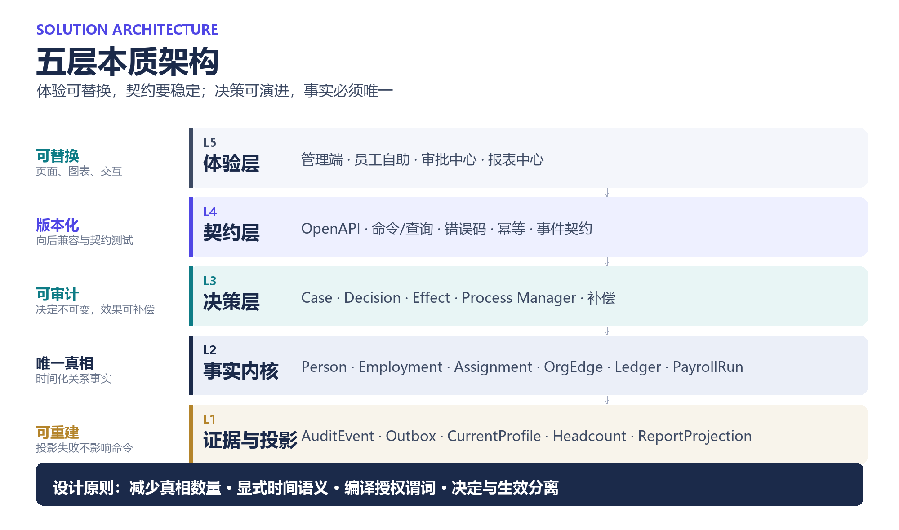
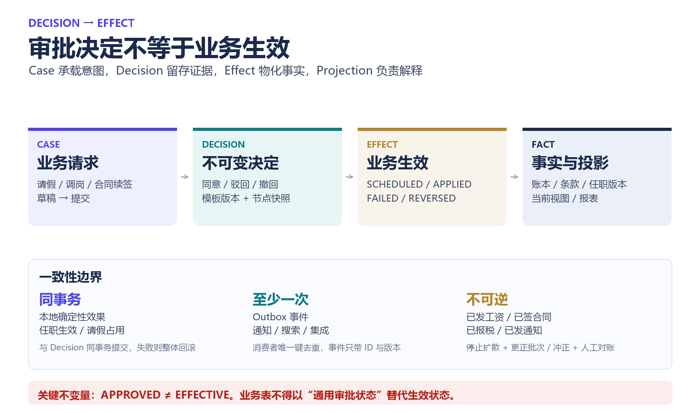

## 00 文档控制与决策摘要

TABLE: 文档基本信息
| 项目 | 内容 |
| 文档性质 | 架构决策与解决方案文档（Decision Dossier），不是功能说明书 |
| 决策依据 | 《企业级人事管理系统（HRMS）V1.0 完整实施书》，2026-11-23 |
| 适用对象 | 项目发起人、产品负责人、架构师、前后端工程师、QA、DevOps、HR 业务负责人、审计与法务 |
| 文档状态 | 决策基线 v1.1：技术/业务结论已按推荐研究定稿（见附录 E）；组织授权签字按 16.2 在 W2–W8 完成，未签项不阻断设计定稿，但阻断对应 release |
| 版本与日期 | v1.1 / 2026-11-23 |
| 关联文档 | 《HRMS V1.0 实施计划：30 周落地路线图》 |
| 设计边界 | 不替代法定税务申报、银行清算、人脸识别算法、电子签章等外部专业系统 |

> LEAD: 这份方案不再从“还缺哪些页面、还缺哪些角色、还缺哪些审批节点”开始。它先回答一个更基础的问题：人事系统真正需要长期保存的真相是什么，哪些东西只是可以重算的视图。

### 0.1 五条决策

1. **采用“时间化关系事实 + 能力锚点授权 + 决策与生效分离 + 账本与关账 + 可重建投影”作为系统内核。** 员工不是一张表，而是自然人与法律雇主之间、在某段时间内成立的关系集合。
2. **保留原实施书的全部业务域，但重定深度。** 组织人事、合同、考勤、假勤、薪酬、审批、报表、自助做事务级深度；招聘、绩效、培训做闭环薄切片；外部设备、SSO、银行、税务、电子签只做适配层。
3. **权限不再做任意组合的配置矩阵。** 能力（Capability）由代码定义，授权（AuthorityBinding）由数据表达；角色只是能力包。删除 `condition_json`、独立字段策略和任意 SQL 自定义范围。
4. **审批通过不等于业务生效。** 用 Case–Decision–Effect 分离“意图、决定、生效”，本地确定性效果与决定同事务，Outbox 只负责通知和外部集成。
5. **交付改为骨架先行、风险纵切、分批可用、统一验收。** 30 周是 P50 基准，P80 应承诺 38–44 周；任何发布门禁不得用“先上线后补测”交换。

### 0.2 本方案已定稿的不可逆选择

TABLE: 已定稿的不可逆选择
| 选择 | 定稿结论 | 一旦有真实数据后的返工代价 | 依据 |
| 员工与任职分离，组织归属用 Assignment 表达 | 采用 Person–Employment–Assignment | 极高：历史考勤、工资、合同、报表全部要重算 | 附录 E / ADR-0002 |
| `tenant_id` 与 `legal_entity_id` 分开 | 采用；租户是隔离边界，法人是雇主/合同/工资/税务边界 | 高：多法人、跨公司调动、工资主体会被混在一起 | 附录 E D-02 |
| 工资批次封存后只允许更正批次 | 采用；已发放/已申报批次不可改，只能新建更正批次 | 高：已发工资、个税、社保、银行回单不可逆 | 附录 E / ADR-0007 |
| 审批决定与业务生效分离 | 采用 Case–Decision–Effect；本地效果同事务，外部效果走 Outbox | 高：所有业务状态、待办、报表都要改 | 附录 E / ADR-0005 |
| 数据权限按 Anchor 编译成查询谓词 | 采用 Capability × 七类 Anchor × P0–P3 字段档位 | 高：所有列表、详情、导出、报表都要改 | 附录 E / ADR-0004 |

> NOTE: 以上五项已按推荐完成研究并定稿，状态均为 `DECIDED`（见附录 E）。发起人签字确认的是资源、范围与治理授权，不是重新打开技术结论；如要变更，按 16.3 的 ADR/CCB 流程处理。

### 0.3 本方案明确不做

- 不做通用 BPMN 设计器，只做数据库驱动的有限状态机与节点规则。
- 不做微服务拆分，不做以事件溯源作为主存储。
- 不做图数据库或 Zanzibar 式分布式授权，V1.0 的规模用 MySQL 闭包表与编译谓词足够。
- 不做任意表达式语言、任意 `condition_json`、任意自定义 SQL 数据范围。
- 不做多租户 SaaS 计费、原生 App、人脸识别算法、税务申报引擎、银行清算系统。
- 不把“配置越多”当成“越灵活”。配置是产品能力，不是逃避领域建模的工具。

### 0.4 一页结论

TABLE: 方案摘要
| 维度 | 原实施书的默认路径 | 本方案的本质解 | 预期结果 |
| 事实模型 | 员工表 + 部门字段 + 历史 JSON | Person–Employment–Assignment + 有效期 | 历史、未来生效、兼岗、借调、跨公司可解释 |
| 权限 | RBAC + 数据范围 + 字段策略 + 条件 JSON | Capability × Anchor 编译为 SQL 谓词 | 组合爆炸下降，拒绝可解释，字段不旁路 |
| 流程 | 审批状态写在业务表 | Case–Decision–Effect | 审批与生效不再互相冒充 |
| 钱与假 | 余额字段、工资条可改 | 账本 + 关账 + 更正批次 | 可对平、可追溯、可审计 |
| 报表 | 各模块各自聚合 | 统一投影 + as-of 查询 | 指标、下钻、导出口径一致 |
| 交付 | W01–W11 顺序 + 一次上线 | 骨架 + 纵切 + 分批切换 | 风险更早暴露，回滚边界清楚 |

---

## 00A 一页决策简报

> LEAD: 如果只给发起人一页纸，这一页应该足够确认资源、范围与治理授权。设计结论已经定稿；启动后 6 个月应有骨架、核心人事与假勤账本可用，工资进入影子；12 个月完成分域切换并可对账。其余章节是论证、约束与证据。

TABLE: 四个已定稿的关键决定
| # | 决定 | 定稿结论 | 不定稿的后果 |
| 1 | 采用五层事实内核 | 已定稿，采用（ADR-0002/0004/0005） | 后续每个模块自建真相 |
| 2 | 接受“范围不缩水、深度分层、顺序重排” | 已定稿，接受（范围基线见 13.4） | 30 周不可达，或质量门禁被绕过 |
| 3 | 批准 30 周 P50 / 38–44 周 P80 | 已定稿，按 P50 30 周 / P80 38–44 周承诺 | 后期压缩测试、迁移与工资平行 |
| 4 | 安全、工资、迁移门禁不可豁免 | 已定稿，不可豁免；豁免权不存在 | 虚假完成与上线事故 |

TABLE: 六个问题、本质解与代价
| 问题 | 本质解 | 代价与回报 |
| 员工、组织、岗位的历史与未来生效乱 | Person–Employment–Assignment + 有效期 | 查询更复杂；换来兼岗、借调、跨公司、返聘可解释 |
| 权限越配越复杂，仍可能越权 | Capability × 七类 Anchor 编译成 SQL 与字段投影 | 配置自由度下降；换来可测试、可解释、无逐行判权 |
| 审批通过但业务没生效 | Case–Decision–Effect 分离 | 状态更多；换来工资、假勤、合同的一致性 |
| 余额、工资条被直接改 | 账本 + 关账 + 更正批次 | 更正视导更长；换来可对账、可审计 |
| 报表各算各的 | 统一投影 + as-of 查询 + 同源授权 | 实时性下降；换来管理层信任 |
| 一次全量上线风险集中 | 骨架 + 纵切 + 分批切换 + 统一验收 | 需要 release 治理；换来风险早暴露、可回滚 |

> IMPORTANT: 这份方案不是“更慢”，而是把不可逆的风险提前暴露。真正会拖慢项目的，不是第 4 周打通骨架，而是第 30 周才发现工资、权限和历史模型需要重做。

## 01 问题重述：系统到底在管什么

> LEAD: 如果把 HRMS 当成“员工数据的增删改查”，那么权限、审批、报表都会变成外挂。真正需要建模的是关系、时间、决定和账目。

### 1.1 五个不可约问题

任何 HRMS，无论界面叫什么，最终都在回答五个问题：

TABLE: HRMS 的五个不可约问题
| 问题 | 典型业务 | 如果答错会怎样 |
| 谁与谁在什么时间成立了什么关系 | 入职、转正、调岗、借调、离职、返聘、跨公司调动 | 工龄、年假、合同、社保、工资主体错位 |
| 这个人在什么组织、岗位、汇报线上 | 部门树、岗位编制、矩阵经理、代理审批 | 数据权限、审批人、编制报表全部漂移 |
| 发生了什么，以什么证据为准 | 打卡、请假、加班、出差、合同签署、绩效结果 | 争议时无法还原，工资无法复算 |
| 谁可以因为什么目的、在多长时间内知道或操作 | 工资、证件、银行卡、合同、报表导出 | 越权、隐私泄露、审计失效 |
| 应该付多少、扣多少、什么时候关账 | 计薪、假勤结算、补发补扣、离职结算 | 错发、漏缴、无法冲正、财务对不上 |

### 1.2 由此得到的最小内核

本方案把系统压缩成五类原语：

1. **Person**：自然人身份。一个人可以有多段任职、返聘、集团内再入职。
2. **Employment**：人与法律雇主之间的雇佣关系，有起止、用工类型、合同与条款。
3. **Assignment**：某段任职在某个时间范围内所属的组织、岗位、汇报线。兼岗、借调、矩阵经理都落在这里。
4. **Fact**：在业务世界里成立的事实，例如打卡、请假占用、合同版本、工资行。事实有生效时间、记录时间与来源。
5. **Decision / Effect**：谁在什么时候做了什么决定，以及这个决定是否已经生效、何时生效、是否被冲正。

围绕这五类原语，才有 WorkTime、Money、Authority、Document、Projection 这些派生概念。把它们直接做成主表，系统的真相就会碎成很多份。

### 1.3 三条不变量与一条投影规则

> KEY: 不变量比功能清单更重要。功能可以加，真相不能分裂。

- **不变量 A：任何业务事实都必须有主体、有效期、记录时间和来源。** 没有来源的字段不允许进入工资、合同、报表或审计。
- **不变量 B：任何授权都必须有主体、能力、锚点、目的和有效期。** “管理员”不是万能通行证，“角色名”不是授权依据。
- **不变量 C：任何已关账期间的钱与假勤，只能通过冲正或更正改变，不能覆盖原记录。**
- **投影规则：当前视图、余额、编制、报表、搜索索引都是投影，必须可以从事实重建。**

### 1.4 什么叫“本质方案”

本质方案不是更抽象的架构图，而是满足四个条件：

TABLE: 本质方案的四个检验
| 检验 | 问题 | 本方案的回答 |
| 减少真相数量 | 同一件事是否只在一个地方拥有权威版本 | 任职、组织、合同、假勤、工资各自只有一个事实源 |
| 时间可解释 | 任意历史时点能否回答“当时是谁、在哪、为什么” | 所有关键关系有 valid time 与 transaction time |
| 权限可编译 | 能否在不逐行判权的情况下生成安全查询 | Capability × Anchor 编译成 SQL 谓词与字段投影 |
| 变更可回退 | 决策、生效、关账、切换是否有明确回退边界 | 决策与生效分离，关账只冲正，切换分域回滚 |

> IMPORTANT: 如果只能记住一句话：**系统管理的不是员工表，而是人与组织之间随时间变化的关系，以及由这些关系产生的决策、事实和账目。**

---

## 02 原实施书的八个隐含假设

> LEAD: 原实施书的方向大体正确：单人员主档、统一权限中心、审批解耦、历史可追溯、默认拒绝。问题在于，它把这些原则落成了“模块 + 权限开关 + 审批流”的实现路径。

### 2.1 八个需要校正的假设

TABLE: 隐含假设与校正
| # | 隐含假设 | 为什么看起来合理 | 在哪里失效 | 本方案的校正 |
| 1 | 模块清单就是系统架构 | 页面、导航、工作包都按模块组织 | 模块只描述功能切片，不描述跨模块共享的真相 | 先定事实内核，再定模块边界 |
| 2 | 员工 = `employees` 表 + 当前部门字段 | 大多数 HR 系统都这样起步 | 兼岗、借调、矩阵经理、跨公司、返聘无法表达 | Person–Employment–Assignment 三层 |
| 3 | 有效期 + before/after JSON + 审计 = 历史 | 看起来能记录变更 | JSON 不是可查询的版本模型，审计不是业务历史 | valid time + transaction time + 追加版本 |
| 4 | RBAC + DataScope + FieldPolicy + Ownership + condition_json 可以正交组合 | 每个维度单独看都合理 | 维度语义耦合，独立字段策略会扩权，JSON 条件不可判定 | 能力目录 + 锚点绑定 + 字段档位，统一解析 |
| 5 | 审批通过 = 业务生效 | 审批是 HR 最熟悉的控制手段 | 审批成功但生效失败、重复生效、未来生效被提前执行 | Case–Decision–Effect 分离 |
| 6 | 余额、编制、统计是可以直接写的字段 | 页面需要一个数字 | 并发扣减、撤销、追溯、跨期更正会产生负数与漂移 | 账本 + 投影 + 对账 |
| 7 | 软删除 + `updated_at` 可以承担历史 | 开发成本最低 | 无法回答“当时系统知道什么”，也无法复现旧工资 | 记录时间轴与不可变关账 |
| 8 | 一次全量交付能降低范围风险 | 承诺完整，避免二期扯皮 | 集成、工资、迁移风险全部压到最后，虚假完成 | 纵切交付、分批可用、统一验收 |

### 2.2 模块优先路径的二阶与三阶后果

TABLE: 模块优先路径的影响链
| 触发变化 | 直接效果 | 二阶效应 | 三阶效应 | 本方案的阻断点 |
| 每个模块自己解释“员工当前部门” | 单模块开发快 | 同一员工在不同模块归属不同 | 工资成本中心、考勤排班、报表口径长期对不上 | Assignment 单一事实源 |
| 权限在页面和接口各写一遍 | 页面看起来受控 | 导出、报表、附件下载出现旁路 | 越权泄露后无法证明系统可控 | 统一 Authorizer 编译谓词 |
| 审批状态写进业务表 | 查询方便 | 审批与业务双状态漂移 | 出现“已通过但未生效”或“已生效但审批撤回” | Decision 与 Effect 分离 |
| 用余额字段做假勤 | 页面简单 | 撤销、跨期、并发导致负数 | 员工不信任，HR 用 Excel 另建真相 | 记账 + 投影 + 对账 |
| 报表各自聚合 | 单张报表上线快 | 指标、下钻、导出不一致 | 管理层不再相信系统，决策回到手工 | 统一投影与 as-of 查询 |
| 所有配置都做成可编辑 | 实施灵活 | 配置成为第二套程序语言 | 没人能解释某次授权/工资为什么这样算 | 配置边界 + 代码拥有的能力目录 |

### 2.3 原书中值得保留的六个原则

TABLE: 保留、重写与删除
| 原书原则 | 处理 | 说明 |
| 一个人员主档案，员工 ID 永不复用 | 保留 | 但主档案应是 Person，员工视图是 Employment 的投影 |
| 一个权限中心 | 保留 | 但权限中心不是“配置所有维度”，而是统一解析能力与锚点 |
| 审批与业务解耦 | 保留 | 解耦的正确方式是 Decision 与 Effect 分离，不是两套状态各写一半 |
| 配置优先 | 有条件保留 | 假期类型、班次、工资项目、模板可配置；核心事实、能力语义、状态机必须代码化 |
| 安全默认拒绝 | 保留 | 默认无权限、默认隐藏字段、默认禁止导出 |
| 历史可追溯 | 保留 | 但历史不是审计日志，而是可查询的版本与关账记录 |
| `company_id` 预留集团 | 重写 | 拆成 `tenant_id` 与 `legal_entity_id`，避免租户、法人、工资主体混为一谈 |
| 一次全量交付 | 删除 | 改为分批可用、统一验收；范围不缩水，但深度分层、顺序重排 |

### 2.4 原书没有说清的三件事

1. **谁拥有事实。** 员工、组织、考勤、工资、合同都写“关联员工”，但没有定义哪个模块是某类事实的唯一写入者。
2. **历史按哪个时间回答。** 是业务发生时间、系统记录时间，还是工资归属期间？原书多处混用。
3. **配置错了如何回滚。** 角色、审批模板、工资规则、组织树都可以配置，但缺少版本、生效期、影响预览与回滚机制。

> WARNING: 如果这三件事不在开发前定清楚，后面每加一个模块，都会多一套“看起来能用、但对不上”的局部真相。

### 2.5 对原书的裁决

原书不是“错”，而是“只完成了产品侧的需求定义，还没有完成工程侧的语义定义”。它的功能覆盖可以作为需求基线，权限原则可以作为安全基线，但数据模型、时间语义、决策生效、账本与投影必须按本方案重写。否则开发团队会在每个模块里重新发明一套解释，最后靠人对人、表对表地补洞。

裁决可以概括为三句话：

1. **范围保留**：17 章列出的业务域、角色、验收项不删。
2. **语义重写**：员工、任职、组织、时间、权限、审批、余额、工资的“真相”重新定义。
3. **交付重排**：从“模块顺序 + 一次上线”改为“骨架 + 纵切 + 分批切换 + 统一验收”。

---

## 03 备选路线与选择

> LEAD: 不是所有复杂都值得自研。本方案比较六条路线，重点看长期维护成本，而不是第一版开发速度。

### 3.1 评估标准

TABLE: 方案评估权重
| 标准 | 权重 | 说明 |
| 正确性与可审计 | 25% | 历史、工资、假勤、合同能否复算与解释 |
| 安全与隐私 | 20% | 越权、字段泄露、导出扩散、撤权时效 |
| 变更成本 | 15% | 新增模块、字段、审批、报表时的改动范围 |
| 首次可用时间 | 15% | 多久能跑通真实业务，而不是演示 |
| 运维与认知负担 | 10% | 部署、排障、培训、交接 |
| 生态与招聘 | 10% | Laravel、Vue、MySQL 人才与社区 |
| 扩展性 | 5% | 集团、多法人、外部集成、未来拆分 |

### 3.2 六条路线

六条路线覆盖自研、平台、分布式授权、时间化内核、外购与混合。评分的重点不是“谁功能多”，而是“谁能让工资、假勤、权限和迁移在三年后仍然可解释”。

TABLE: 备选方案对比
| 方案 | 核心做法 | 优势 | 代价 | 适用判断 |
| A 原书模块优先 | 按 W01–W11 建模块，RBAC + 数据范围 + 字段策略 | 容易理解，页面覆盖快 | 真相分散，权限组合爆炸，后期返工大 | 只适合小规模、低变更、非财务关键系统 |
| B 低代码/BPM 平台 | 用表单、流程、规则引擎承载大部分业务 | 业务人员可配置，短期灵活 | 复杂规则不可测，性能与审计受限，平台锁定 | 适合审批型外围，不适合工资与假勤内核 |
| C ReBAC/Zanzibar 式 | 用关系图表达权限，集中授权服务 | 表达力强，适合超大规模协作 | 运维复杂，V1.0 规模不需要，团队学习成本高 | 10 万级以上、跨产品统一授权时再考虑 |
| D 时间化关系内核 | Person–Employment–Assignment + 双时间 + 决策/生效 + 账本 | 正确性高，跨模块一致，长期成本低 | 建模与查询更复杂，需要培训 | 本项目的核心方向 |
| E 直接购买 SaaS | 采购成熟 HRMS，少量定制 | 上线快，法定更新由厂商负责 | 数据驻留、流程适配、集成与退出成本高 | 适合 HR 非差异化、预算明确、愿意接受标准流程 |
| F 混合：D + 购买商品能力 | 自研事实内核与差异化流程，购买税务、银行、设备、电子签 | 兼顾正确性与上市时间，避免自研法定引擎 | 需要清晰的适配层与供应商治理 | 本项目推荐 |

### 3.3 定性评分

TABLE: 方案评分（1–5 分，按权重加权）
| 方案 | 正确性 25% | 安全 20% | 变更 15% | 首值 15% | 运维 10% | 生态 10% | 扩展 5% | 加权 |
| A 原书模块优先 | 2 | 2 | 2 | 4 | 4 | 5 | 2 | 2.80 |
| B 低代码/BPM | 3 | 2 | 4 | 4 | 2 | 3 | 4 | 3.05 |
| C ReBAC/Zanzibar | 4 | 4 | 3 | 2 | 2 | 3 | 4 | 3.25 |
| D 时间化关系内核 | 5 | 5 | 4 | 3 | 4 | 4 | 4 | 4.30 |
| E 直接购买 SaaS | 4 | 4 | 2 | 5 | 4 | 2 | 2 | 3.55 |
| F 混合方案 | 5 | 5 | 4 | 4 | 4 | 4 | 4 | 4.45 |

> NOTE: 评分不是市场调研结论，而是基于本项目约束的定性判断：单公司试点、1–3k 员工、Laravel/Vue 团队、工资与假勤必须可审计、外部集成不能进关键路径。

### 3.4 为什么选 F，而不是 D 或 E

选 F 的理由不是“什么都做”，而是把自研集中在真正差异化的地方：

- **自研**：人员与任职、组织与时间、决策与生效、假勤账本、工资批次与更正、权限编译、审计与对账。这些是 HRMS 的骨架，外购无法贴合。
- **购买或适配**：法定个税/社保口径、银行代发、电子签章、考勤设备、SSO/企业微信/钉钉/飞书。这些是受监管或强生态依赖的商品能力。
- **不买核心事实**：员工、任职、假勤、工资批次不能锁在不可导出的 SaaS 黑盒里；至少要有可迁移的数据契约。

### 3.5 为什么不做 BPMN、微服务、事件溯源主存

TABLE: 三个常见“架构升级”的适用边界
| 技术 | 诱人的理由 | 本项目的现实 | 结论 |
| 通用 BPMN 设计器 | 流程可以随便画 | 节点类型、审批人解析、业务副作用、审计都需要领域代码；画图不等于可执行 | 只做有限节点与模板版本 |
| 微服务 | 模块解耦、独立部署 | 8 人团队、单库事务、跨模块一致性要求高；分布式事务会放大成本 | 模块化单体，边界靠契约与架构测试 |
| 事件溯源主存 | 天然历史、可重放 | 查询、迁移、权限、报表都变复杂；团队没有成熟经验 | 事实表追加 + 决策/生效事件，不做全量事件溯源 |

> KEY: 本质解不是“用更复杂的技术”，而是“用更少的真相、更清楚的时间、更可验证的边界”。

---

### 3.6 选择之后，什么情况下应当推翻

TABLE: 方案切换的触发条件
| 触发条件 | 应当重新评估 | 不应做的事 |
| 公司从单法人扩展到 10 个以上法人 | 法人配置中心、跨境数据流、集团权限 | 直接把 `company_id` 当租户 ID 扩用 |
| 员工数超过 10 万或并发超过 5,000 | 读写分离、分区、独立授权服务 | 在没有压测数据前先拆微服务 |
| 外部集成超过 20 个 | 集成平台、事件总线、API 网关 | 让每个集成直接写业务表 |
| 业务要求通用流程编排 | 评估 BPMN/规则引擎，但隔离副作用 | 用流程引擎直接改工资/假勤事实 |
| 团队规模超过 50 人、多地域 | 按模块拆团队，评估服务边界 | 为了“组织架构”提前分布式 |

> KEY: 选型不是一次投票，而是一组可复审的假设。每个假设都要有触发条件和退出路径，否则架构会变成信仰。

## 04 本质解：五层模型

> LEAD: 目标架构可以用五层描述。越往下越稳定，越往上越可替换。任何新功能都应该先问：它改变的是哪一层？

### 4.1 架构总览



TABLE: 五层职责
| 层 | 职责 | 典型对象 | 不允许做的事 |
| 体验层 | 管理端、自助端、报表、审批中心 | 页面、表单、列表、仪表盘 | 直接决定权限，直接写数据库 |
| 契约层 | REST/OpenAPI、命令、查询、错误、幂等 | `/v1/...`、DTO、错误码 | 把内部表结构暴露给前端 |
| 决策层 | 意图、审批、生效、补偿 | Case、Decision、Effect、Process Manager | 把审批状态写进业务事实表 |
| 事实内核 | 人、任职、组织、时间、条款、假勤、工资 | Person、Employment、Assignment、OrgUnit、Ledger、PayrollRun | 让外围模块拥有员工真相 |
| 证据与投影 | 审计、事件、当前视图、报表、搜索 | AuditEvent、Outbox、CurrentProfile、Headcount | 把投影当真相回写 |

### 4.2 内核、投影与外围

TABLE: 三类对象的边界
| 类别 | 定义 | 对象示例 | 变更规则 |
| 内核 | 业务真相，必须可追溯 | Person、Employment、Assignment、OrgUnit、EmploymentTerms、LeaveLedgerEntry、PayrollRun、Payslip、Decision、Effect | 追加版本或状态机，禁止覆盖 |
| 投影 | 从事实重算的读模型 | 当前员工档案、组织架构图、编制、考勤日汇总、假期余额、工资登记表、仪表盘 | 可重建，允许最终一致，必须有新鲜度指标 |
| 外围 | 引用内核 ID 的业务域 | 招聘、绩效、培训、公告、导入导出、通知、集成 | 不拥有员工真相，不跨模块写表 |

### 4.3 模块边界与依赖规则

TABLE: V1.0 模块边界
| 模块 | 拥有的表 | 对外提供 | 依赖 |
| IAM | 用户、会话、能力目录快照、授权绑定、审计事件 | 认证、能力查询、授权解析 | Platform |
| Organization | 组织单元、闭包、岗位目录 | 组织树、as-of 组织查询、岗位查询 | People（仅人员引用） |
| People | Person、Employment、Assignment、Terms、Documents | 员工档案、任职、合同条款、履历 | Organization |
| Lifecycle | Case、Decision、Effect、入转调离任务 | 入职、转正、调岗、离职、合同续签 | People、Workflow |
| Workflow | 流程定义、版本、运行实例、任务 | 审批模板、待办、决定记录 | IAM |
| Time | 班次、排班、打卡、考勤日、假勤账本 | 考勤事实、请假/加班/出差、余额投影 | People、Workflow |
| Payroll | 薪资项目、方案、批次、工资条、更正 | 计薪、复核、发布、工资条 | Time、People、Workflow |
| Talent | 招聘、绩效、培训 | 候选人、考核、培训记录 | People、Workflow |
| Engagement | 公告、通知、员工自助聚合 | 公告、消息、自助首页 | 所有模块的只读契约 |
| Reporting | 报表定义、投影刷新、导出任务 | 指标、下钻、导出 | 所有模块的投影 |
| Platform | 文件、字典、参数、Outbox、审计、任务 | 基础设施能力 | 无业务依赖 |

**依赖规则：**

- 业务模块只能引用其他模块的公开契约或 ID，不得直接写对方的表。
- Reporting 只读投影，不直接读业务表；需要新指标时先加投影或查询契约。
- Platform 不得反向依赖业务模块；业务模块通过接口注册能力、任务和事件。
- 任何跨模块一致性都通过 Decision/Effect 或 Outbox 事件，不通过“两个 Service 互相调用然后各自提交”。

### 4.4 一次请求如何穿过五层

以“部门经理给下属批准请假”为例：

1. 前端提交 `POST /v1/leave-cases`，带 `Idempotency-Key`。
2. IAM 认证用户，Authorizer 解析 `leave.request.approve` 能力。
3. Anchor 解析：当前用户的有效任职 → `MANAGED` 锚点 → 下属的 Employment 集合。
4. 查询用编译后的 SQL 谓词过滤，字段按当前绑定的 FieldProfile 投影。
5. Workflow 创建审批任务；经理提交决定，生成不可变 Decision。
6. Effect Handler 在同一事务内占用假期账本；若跨月或需要外部通知，写 Outbox。
7. Reporting 的余额与考勤日投影异步刷新；审计事件记录决定、生效、拒绝与字段访问。
8. 如果审批通过但生效失败，Effect 进入 `FAILED`，可重试或补偿；业务表不会出现“已通过但没扣假”的假状态。

### 4.5 架构取舍

TABLE: 本质解的代价与回报
| 取舍 | 代价 | 回报 | 缓解 |
| 更多关联查询 | 列表 SQL 更复杂，开发门槛更高 | 兼岗、借调、历史、未来生效一次解决 | 提供 as-of 查询助手与视图 |
| 更显式状态 | Case、Decision、Effect、Run 状态更多 | 不再出现审批与业务互相冒充 | 统一时间线与状态投影 |
| 更少配置 | 管理员不能任意加条件 | 授权可解释、可测试、可审计 | 能力目录 + 发布流程 + 影响预览 |
| 更晚的首个演示 | 不能先堆页面 | 更早跑通真实月度闭环 | 4 周骨架 + 试点数据 |
| 更多测试 | 时间旅行、账本、权限负测 | 上线后返工与争议减少 | 自动化生成测试矩阵 |

> IMPORTANT: 这套架构不是“更优雅”，而是为了让工资、假勤、合同、组织在同一个时间坐标上说话。只要这些模块需要互相解释，时间化关系就不是可选项。

---

## 05 事实内核：Person–Employment–Assignment

> LEAD: 原书的 `employees 1—N employments` 是正确方向，但还少了一层 Assignment。没有 Assignment，兼岗、借调、矩阵汇报、跨公司、岗位编制都只能塞进备注或 JSON。

### 5.1 三个对象的定义

TABLE: 人员模型三层
| 对象 | 回答的问题 | 关键字段 | 生命周期 |
| Person | 这个自然人是谁 | 法定姓名、证件、出生日期、联系方式 | 长期存在，可有多段任职 |
| Employment | 这个人与哪个法律雇主、以什么用工关系建立雇佣 | 法人、工号、入职/离职、用工类型、状态 | 一段任职，可有多次续签/变更 |
| Assignment | 在这段任职的某个时间段，他在哪个组织、岗位、向谁汇报 | 组织、岗位、经理、任职类型、有效期 | 可多段、可并行、可未来生效 |

### 5.2 为什么两层模型不够

TABLE: 两层模型无法表达的场景
| 场景 | 只有 Employee–Employment 会发生什么 | 有 Assignment 后如何表达 |
| 兼岗 | 把第二个部门塞进备注或自定义字段 | 两条并行的 Assignment，主岗标记 `PRIMARY` |
| 借调 | 改当前部门，历史报表漂移 | 新增借调 Assignment，有效期结束后回到原岗 |
| 矩阵经理 | 一个 `manager_id` 无法表达业务线与行政线 | Assignment 上分别记录行政经理与业务经理 |
| 跨公司调动 | 改 `company_id`，旧公司历史被新公司看到 | 旧 Employment 结束，新 Employment 开始，Person 不变 |
| 返聘 | 复用旧员工记录，工龄与合同混乱 | 新 Employment，Person 相同，工龄规则可配置 |
| 岗位编制 | 员工表上写岗位，编制无法按时间核算 | Position 是目录，Assignment 占编，Headcount 是投影 |

### 5.3 组织与闭包

组织树不能只存 `parent_id`。数据权限、报表、审批人解析都需要“某时点的下级组织集合”。本方案使用：

- `org_units`：组织单元，含 `tenant_id`、`legal_entity_id`、`parent_id`、类型、有效期。
- `org_unit_closure`：祖先–后代闭包，含有效期；组织移动时追加新版本，不覆盖旧路径。
- `positions`：岗位目录，不等同于员工当前岗位。
- `assignments`：员工在组织与岗位上的占用，含有效期与汇报关系。

组织移动必须先做影响预览：影响多少员工、多少审批人、多少报表、多少历史工资成本中心。移动后旧闭包不删除，按 `valid_to` 结束。

### 5.4 合同不是一张表，而是条款与证据

合同至少包含两类东西：

- **条款（EmploymentTerms）**：岗位、工资方案、试用期、工作地点、工时制度、保密/竞业等，有有效期与版本。
- **文件与签署证据（Documents / Signatures）**：合同 PDF、签署时间、签署人、哈希、版本。

续签不是覆盖旧合同，而是新增条款版本与文件版本；到期预警是投影，不是合同状态字段。这样工资、社保、试用期、无固定期限触发都能从条款时间线推导。

### 5.5 关键表结构示意

```sql
-- 只表达结构，迁移中需补齐审计列、索引、外键与约束
CREATE TABLE persons (
  id BIGINT PRIMARY KEY,
  tenant_id BIGINT NOT NULL,
  legal_name VARCHAR(120) NOT NULL,
  id_type VARCHAR(32) NULL,
  id_number_ciphertext VARBINARY(512) NULL,
  birth_date DATE NULL,
  created_at DATETIME(6) NOT NULL,
  updated_at DATETIME(6) NOT NULL
);

CREATE TABLE employments (
  id BIGINT PRIMARY KEY,
  tenant_id BIGINT NOT NULL,
  person_id BIGINT NOT NULL,
  legal_entity_id BIGINT NOT NULL,
  employee_no VARCHAR(64) NOT NULL,
  employment_type VARCHAR(32) NOT NULL,
  status VARCHAR(24) NOT NULL,
  valid_from DATE NOT NULL,
  valid_to DATE NOT NULL,
  recorded_at DATETIME(6) NOT NULL,
  superseded_at DATETIME(6) NULL,
  source_type VARCHAR(32) NOT NULL,
  source_id BIGINT NULL,
  UNIQUE KEY uk_employment_no (tenant_id, legal_entity_id, employee_no)
);

CREATE TABLE assignments (
  id BIGINT PRIMARY KEY,
  tenant_id BIGINT NOT NULL,
  employment_id BIGINT NOT NULL,
  org_unit_id BIGINT NOT NULL,
  position_id BIGINT NULL,
  manager_assignment_id BIGINT NULL,
  assignment_type VARCHAR(24) NOT NULL,
  is_primary TINYINT(1) NOT NULL DEFAULT 0,
  valid_from DATE NOT NULL,
  valid_to DATE NOT NULL,
  recorded_at DATETIME(6) NOT NULL,
  superseded_at DATETIME(6) NULL,
  source_type VARCHAR(32) NOT NULL,
  source_id BIGINT NULL,
  CHECK (valid_from < valid_to)
);

CREATE TABLE org_unit_closure (
  ancestor_id BIGINT NOT NULL,
  descendant_id BIGINT NOT NULL,
  depth INT NOT NULL,
  valid_from DATE NOT NULL,
  valid_to DATE NOT NULL,
  PRIMARY KEY (ancestor_id, descendant_id, valid_from)
);
```

### 5.6 不变量

- 同一 Employment 的 `PRIMARY` Assignment 在同一业务日不得重叠。
- `tenant_id` 是隔离边界，`legal_entity_id` 是雇主、合同、工资、税务与社保主体；工号在租户加法人内唯一（D-02）。
- Assignment 的组织必须在其有效期内属于同一 `legal_entity_id`，跨法人必须新建 Employment 或显式借调关系；共享服务组织通过显式映射表达，不靠改组织法人。
- 任何工资、考勤、合同事实必须能追溯到 `employment_id`，必要时追溯到 `assignment_id`。
- 当前员工视图必须由 `as_of` 查询生成，不能回写 `employments` 的“当前部门”字段。

### 5.7 二阶与三阶影响

TABLE: 人员模型重构的影响
| 触发变化 | 直接效果 | 二阶效应 | 三阶效应 | 缓解 |
| 增加 Assignment | 数据模型更复杂 | 列表、详情、权限、报表都要按 as-of 查询 | 系统能解释兼岗、借调、跨公司，争议下降 | 提供统一查询助手与 UI 组织时间线 |
| Person 与 Employment 分离 | 一个自然人可多段任职 | 招聘、返聘、集团调动需要选择正确 Employment | 工龄、年假、合同连续性可配置 | 入职流程强制选择“新任职/返聘/调动” |
| 组织闭包版本化 | 组织移动不丢历史 | 闭包表增长，需要清理策略 | 历史报表与权限可复现 | 按年分区或归档旧闭包 |
| 合同条款化 | 合同不再是一张可编辑表 | 工资、试用期、续签、预警都要读条款 | 法务与 HR 对合同版本有共同语言 | 合同模板与条款类型受控 |

> WARNING: 如果团队没有 as-of 查询与时间线 UI，Assignment 会被业务用户视为“多出来的表”。这不是模型问题，是产品表达问题。

---

### 5.8 本章裁决

- 员工表不是真相，Person–Employment–Assignment 才是。
- 组织归属不是字段，而是带有效期与汇报关系的关系。
- 合同不是附件，而是条款版本与签署证据。
- 任何跨模块引用都必须指向 `employment_id`，必要时指向 `assignment_id`。
- 当前视图只是投影；不能把“当前部门”回写到任职表，否则历史会再次漂移。
- 租户、法人、组织、任职是四个不同边界（D-02）；跨法人不是改一个字段，而是结束旧 Employment、建立新 Employment。

## 06 时间模型：四个日期，不是四个字段

> LEAD: 原书已经提到有效期、快照、生效日、工资月份，但没有把它们分成不同的时间轴。时间语义混用，是 HRMS 最难排查的一类缺陷。

### 6.1 四条时间轴

TABLE: 四条时间轴
| 时间轴 | 回答的问题 | 存储 | 典型用途 |
| valid time | 事实在业务世界何时成立 | `valid_from` / `valid_to`，半开区间 | 任职、组织、合同、工资方案 |
| transaction time | 系统何时知道或替换了这条事实 | `recorded_at` / `superseded_at`，UTC | 追溯更正、审计、复现旧判断 |
| business date | 按哪个法人日历计算“日” | `business_date` + 法人时区/日历 | 考勤日、请假、节假日、跨夜班 |
| payroll period | 哪一期计薪、入账、支付 | `earning_period`、`posting_period`、`pay_date`、`cutoff_at` | 工资计算、财务入账、银行发放 |

### 6.2 as-of 查询

任何历史查询都应支持两个参数：`valid_on` 与 `known_at`。最基本的过滤条件是：

```sql
valid_from <= :valid_on
AND :valid_on < valid_to
AND recorded_at <= :known_at
AND (superseded_at IS NULL OR :known_at < superseded_at)
```

如果只查当前，`known_at` 取当前时间；如果查“当时系统知道什么”，传入历史时刻。工资争议、审计复核、合同续签都依赖这个能力。

### 6.3 未来生效不需要定时改表

审批通过时，直接把 `valid_from` 写在未来，当前视图按日期过滤。Scheduler 只负责提醒、外部副作用和投影刷新，不负责“到点把当前部门改掉”。这样重复执行不会重复生效，提前执行也不会发生。

### 6.4 更正、修订与冲正

TABLE: 三种“改历史”的方式
| 方式 | 适用 | 做法 | 禁止 |
| 更正 Correction | 事实录错，例如部门填错 | 追加新版本，`supersedes_id` 指向旧版，保留证据 | 直接 UPDATE 旧行 |
| 修订 Amendment | 业务条款变更，例如合同续签 | 新增有效期版本，旧版按 `valid_to` 结束 | 覆盖旧合同 PDF |
| 冲正 Reversal | 已关账工资、已结算假勤 | 新增反向分录或更正批次 | 修改已封存批次或已发工资条 |

### 6.5 考勤日与法人时区

打卡时间存 UTC，考勤日按法人所在地时区与公司日历计算。跨夜班次、法定节假日临时调整、调休、时区变化都必须通过 `business_date` 与 `shift` 规则计算，不能用数据库的 `DATE(punched_at)`。

### 6.6 工资期间与截止

工资至少拆四个时间：

- `earning_period`：这段劳动对应哪个计薪期。
- `posting_period`：财务计入哪个月。
- `pay_date`：实际支付日。
- `cutoff_at`：输入冻结时点。

1 月工资在 2 月更正，应该产生 1 月的更正批次或 2 月的补发/补扣批次，而不是改写 1 月已封存的工资条。这个区分决定了能否与财务、税务、银行对账。

### 6.7 不变量与测试

- `valid_from < valid_to`，开区间用 `9999-12-31`，禁止 NULL 表示无限。
- 业务事实不物理删除；需要作废时追加状态与原因。
- 已 `CLOSED` 的工资批次不可修改；更正必须新建 `correction_run`。
- 考勤日、请假、加班、出差必须使用同一业务日历。
- 所有有效期对象必须有 `as_of` 查询测试，覆盖 T-1、T、T+1、跨夜、跨年、时区边界。

### 6.8 二阶与三阶影响

TABLE: 时间模型的影响
| 触发变化 | 直接效果 | 二阶效应 | 三阶效应 | 缓解 |
| 引入双时间 | 查询更复杂 | 开发需要 as-of 助手，报表要标注口径 | 历史争议可复现，审计可信 | 统一 Query Object，禁止手写日期条件 |
| 未来生效不改表 | Scheduler 更简单 | 当前视图必须按日期过滤 | 不会出现“提前生效/重复生效” | 所有 current 视图统一模板 |
| 关账后只冲正 | 工资更正更慢 | 需要更正批次与审批 | 财务可对账，员工能看到更正说明 | 提供更正向导与影响预览 |
| 业务日历独立 | 考勤更准确 | 需要维护节假日与法人时区 | 跨地区扩展更容易 | 日历版本化，变更有审批 |

> KEY: `updated_at` 不是历史，审计日志也不是业务历史。历史是“在某个业务时点成立的事实”，必须能被查询和复算。

---

### 6.9 本章裁决

- `updated_at` 不是历史；审计日志也不是业务历史。
- valid time、transaction time、business date、payroll period 必须分开建模。
- 未来生效不靠定时改表，靠 `valid_from` 与当前视图过滤。
- 关账后的更正只能追加，不能覆盖。
- 任何“按日期回答”的接口都必须显式接受 `as_of` 与 `known_at`。
- 日期区间统一半开，开区间用 `9999-12-31`；时间戳 UTC，业务日按法人 IANA 时区与法人日历（D-03）。

## 07 授权：从配置矩阵到可编译能力

> LEAD: 原书的权限模型方向是对的：默认拒绝、服务端强制、数据范围、字段脱敏。但它把五个维度做成自由组合，最终会得到一个没人能解释的授权矩阵。

### 7.1 为什么五件套会组合爆炸

原书建议 `RBAC + Resource/Action + Scoped Grant + Field Policy + Ownership + condition_json`。单独看每个维度都合理，放在一起会出现三个问题：

1. **语义重复。** “仅在职”是资源状态，“仅本人发起”是 Ownership，“有效期”是授权时间；`condition_json` 没有增加表达力，只增加了歧义。
2. **字段策略会扩权。** grant A 是“本公司 + 脱敏”，grant B 是“本人 + 明文”。如果字段策略独立合并，可能得到“本公司 + 明文”；如果逐行判断，又无法确定该行用哪个配置。
3. **自定义条件不可判定。** 内存过滤会破坏分页、总数、导出；下推 SQL 会引入注入与不可审计；`CUSTOM` 等于第二套无类型编程语言。

TABLE: 组合复杂度的量级
| 维度 | V1.0 量级 | 组合方式 | 结果 |
| 能力动作 | 120–160 | 页面/按钮/API 共用 | 可控 |
| 数据锚点 | 7 类 | 每类绑定不同组织/人/案件 | 可控 |
| 字段档位 | 4 档 | 随能力与锚点解析 | 可控 |
| 角色模板 | 10 个 | 能力包，不允许人名/部门名 | 可控 |
| 任意条件 JSON | 无上限 | 每个角色每个能力可不同 | 不可测试、不可解释 |

### 7.2 能力目录由代码拥有

能力（Capability）是“动作 + 资源 + 可用锚点 + 最大字段档位 + 风险级别 + 职责分离规则”。能力定义在代码中，部署时同步到 `capabilities` 表用于外键、UI 元数据和审计，但**不允许运行时编辑语义**。

```json
{
  "code": "payroll.payslip.read",
  "resource": "payslip",
  "actions": ["read"],
  "anchor_types": ["SELF", "PAYROLL_RUN", "LEGAL_ENTITY"],
  "field_profile_max": "P2_SENSITIVE",
  "risk": "high",
  "sod_group": "payroll_prepare",
  "description": "读取工资条；SELF 仅本人，PAYROLL_RUN 需薪资批次授权"
}
```

能力目录是产品与工程的共同契约：新增能力必须同时有权限码、UI 元数据、后端校验、负向测试和审计事件。不能由管理员在界面上“新建一个权限码”。

### 7.3 授权绑定由数据表达

```sql
CREATE TABLE authority_bindings (
  id BIGINT PRIMARY KEY,
  tenant_id BIGINT NOT NULL,
  principal_id BIGINT NOT NULL,
  capability_code VARCHAR(120) NOT NULL,
  anchor_type VARCHAR(24) NOT NULL,
  anchor_id BIGINT NULL,
  field_profile VARCHAR(24) NOT NULL,
  purpose_code VARCHAR(48) NOT NULL,
  valid_from DATETIME(6) NOT NULL,
  valid_to DATETIME(6) NOT NULL,
  source_type VARCHAR(32) NOT NULL,
  source_id BIGINT NULL,
  auth_version BIGINT NOT NULL,
  created_at DATETIME(6) NOT NULL,
  UNIQUE KEY uk_binding (principal_id, capability_code, anchor_type, anchor_id, valid_from)
);
```

角色不是直接挂到用户身上的“万能钥匙”，而是展开成一组绑定。用户可以有多个角色，同一能力命中多个绑定时：

- **行范围取并集**：每个绑定独立计算允许的 Employment/OrgUnit/Case 集合，再合并。
- **字段档位只能取覆盖该行的绑定并集**，不能把 A 的行范围与 B 的字段权限拼接。
- **强制禁用优先**：账号停用、公司隔离、职责分离冲突优先于任何允许。
- **撤权即时生效**：更新绑定或角色后递增 `auth_version`，下一次请求拒绝旧版本上下文。

### 7.4 只允许七类锚点

TABLE: Anchor 类型
| Anchor | 含义 | 解析方式 | 典型能力 |
| SELF | 本人 | 当前用户绑定的 Employment | 我的档案、我的工资条、我的请假 |
| MANAGED | 我管理的下属 | 当前有效 Assignment 的 `manager_assignment_id` 反向查找 | 经理审批、团队花名册 |
| ORG_UNIT | 指定组织 | 组织 ID + 有效期 | 部门 HR、考勤专员 |
| ORG_SUBTREE | 组织及下级 | 闭包表 as-of 查询 | 部门经理、区域 HR |
| CASE | 特定案件 | 案件成员表 | 招聘面试、绩效校准、个案调查 |
| PAYROLL_RUN | 特定工资批次 | 批次成员/复核人 | 薪酬专员、复核人 |
| LEGAL_ENTITY | 法人 | 法人 ID + 有效期 | 法人 HR、财务、审计 |

“指定部门集合”不是新 Anchor，而是多条 `ORG_UNIT` 绑定；“项目/临时团队”不是 `CUSTOM`，而是 `CASE` 或组织单元。这样锚点数量有限，解析器可测试。

### 7.5 行与字段必须由同一个绑定解析

这是本方案与“独立 FieldPolicy”最大的区别。授权解析的输出不是“一个允许/拒绝”，而是一组 `(row_predicate, field_projection)`：

```php
interface Authorizer
{
    public function constrain(
        Builder $query,
        Principal $principal,
        string $capability,
        BusinessDate $on
    ): Builder;

    public function fields(
        Principal $principal,
        string $capability,
        ResourceRef $row
    ): FieldSet;
}
```

- 列表查询必须先 `constrain()`，再分页、排序、聚合。
- 详情查询先按 ID 取行，再 `fields()` 投影；不允许先序列化再过滤。
- 导出使用同一 `constrain()` 与 `fields()`，并对敏感字段单独检查 `EXPORT` 档位。
- 搜索建议、聚合、附件下载、错误信息都走同一授权入口。

### 7.6 字段档位

TABLE: 字段档位
| 档位 | 返回 | 可用于筛选/排序 | 可用于导出 | 典型字段 |
| P0_PUBLIC | 明文 | 是 | 是 | 姓名、工号、部门、岗位 |
| P1_INTERNAL | 明文或部分遮罩 | 是 | 需导出能力 | 手机、邮箱、地址 |
| P2_SENSITIVE | 遮罩 | 否 | 仅独立导出能力 | 身份证、银行卡、合同金额 |
| P3_RESTRICTED | 隐藏 | 否 | 否 | 工资明细、健康信息、背景调查 |

HIDDEN 字段不得进入 WHERE、ORDER BY、序列化、导出、日志。需要按敏感字段筛选时，使用受控的哈希/分桶索引或独立能力，不允许“用不可读字段做筛选推断”。

### 7.7 角色模板、访问复核与时限授权

TABLE: 角色治理
| 机制 | 规则 | 目的 |
| 角色模板 | 10 个预置模板：超级管理员、系统管理员、HR 管理员、人事专员、招聘专员、薪酬专员、考勤专员、部门经理、普通员工、审计员 | 控制角色数量 |
| 例外角色 | 必须有 owner、业务目的、风险级别、到期日；例外占比目标 ≤5% | 防止角色克隆 |
| 高危权限 | 季度复核；转岗、离职、长休、合同到期触发复核 | 防止授权漂移 |
| 未使用回收 | 90 天未使用的高危授权自动进入回收清单 | 减少攻击面 |
| JIT 授权 | 高危操作默认 8–24 小时，break-glass 双人、30 分钟、全量告警 | 兼顾应急与最小权限 |
| 职责分离 | 制单/复核/发布、授权/审计等毒组合硬阻断 | 防止一人闭环 |
| 可解释授权 | 展示角色→能力→锚点→字段→目的→到期；拒绝给原因 | 让管理员和审计能解释 |

### 7.8 隐私 guardrail

- **最小化**：建立“字段—目的—依据—可访问角色—保留期”五元组，无目的不建字段。
- **告知**：招聘、入职、在职、离职分层告知；监控、定位、录屏单独告知；同意不与劳动合同捆绑。
- **敏感信息**：身份证、银行卡、健康、生物识别、位置逐项评估；默认遮罩、加密、限目的、限时长。
- **导出**：目的 + 审批 + 字段白名单 + 行数上限 + 水印 + 接收人 + 有效期 + 下载次数；敏感字段默认禁止明文批量导出。
- **离职留存**：按记录类型设保留期；到期删除或匿名化；法定留存单独标记，不永久保留。
- **跨境**：境内优先；盘点境外总部、云、运维、客服数据流；跨境访问走审批、录屏、境内跳板。

### 7.9 删除哪些东西

TABLE: 删除清单
| 删除 | 原因 | 替代 |
| `condition_json` | 不可判定、不可测试、容易在内存过滤时泄露分页/总数 | 新增能力或 Anchor Resolver 类 |
| 独立 FieldPolicy | 会与行范围拼接扩权 | 绑定内的 FieldProfile |
| 独立 Ownership | 与 Anchor 语义重复 | `SELF`/`MANAGED`/`CASE` 锚点 |
| `CUSTOM` 任意 SQL | 注入、不可审计、性能不可控 | 受控 Anchor + 查询对象 |
| 角色中文名判断 | 改名即失效，无法审计 | 能力码与绑定 |
| 前端权限作为真相 | 可绕过 | 服务端 Authorizer |

### 7.10 测试与指标

- 每个受保护端点至少 4 类拒绝：未认证、无能力、越锚点、越字段；高危端点至少 8 类，含跨法人、批量、导出、下载、旧 token、撤权后请求。
- 每个 `{id}` 接口做 IDOR 测试；每个导出做字段白名单与行范围测试。
- 指标：能力覆盖率 100%、负向测试覆盖率 100%、高危授权复核率 100%、90 天未用高危授权回收率、撤权生效时延 P95 < 1 秒。
- 身份、会话、MFA 与 break-glass 的定稿参数见 7.11；授权测试必须同时覆盖“旧会话”“改密后旧会话”“离职后代理审批”三类场景。

> WARNING: 没有拒绝率的权限系统，等于没有权限系统。只统计“登录成功”和“页面可访问”没有意义。

### 7.11 身份、会话与 MFA 定稿参数

授权解决“能做什么”，认证解决“你是谁”。两者不能混在一个模型里，也不能把人员事实交给 IdP 托管。V1.0 的身份参数已经定稿（D-09–D-11、ADR-0013）：

TABLE: 身份与会话参数
| 项 | 定稿结论 | 原因 |
| 主认证通道 | 标准 OIDC SSO 为主；企业微信、钉钉、飞书等通过 OIDC 桥接或适配层接入；本地账号作为未覆盖人群与应急兜底 | 避免自建密码体系成为攻击面；不把专有协议和 SSO 排期放进关键路径 |
| 协议范围 | V1.0 只做 OIDC；不做 SAML；SCIM 2.0 只做适配层 | 减少协议矩阵；账号同步失败不能阻塞入职 |
| 账号模型 | User 与 Person 分离；服务账号独立；账号生命周期由入职、离职、转岗事件驱动 | 账号是访问主体，不是自然人 |
| 会话载体 | 第一方 SPA 使用 HttpOnly、Secure、SameSite=Lax 的会话 Cookie，加 CSRF 防护；服务端保存会话 | 避免把 token 放进 localStorage 被 XSS 读取 |
| 会话时长 | 标准用户总时长 12 小时、空闲 30 分钟；特权用户 8 小时、空闲 15 分钟 | 严于 NIST AAL2 的 24 小时/1 小时基线 |
| 撤权 | 每个请求校验 `auth_version`；离职、转岗、改密、设备丢失即时吊销，下一次请求 403 | 权限变化不能等到 token 过期 |
| MFA | TOTP 与 WebAuthn；特权与薪酬角色强制；短信/邮件验证码不作为第二因子 | 短信与邮件可被拦截或劫持 |
| 高风险 step-up | 工资导出、角色变更、break-glass、银行文件生成前重新认证 | 高风险动作不能沿用低保证会话 |
| break-glass | 双人、30 分钟、必须填理由、全量告警、自动过期；不保留永久超级管理员 | 应急通道必须存在，但必须可审计、可回收 |

> WARNING: 不要把“接了 SSO”当成完成了身份治理。SSO 只解决认证；账号与任职的对应、离职吊销、代理审批、服务账号、break-glass 仍然必须由本系统负责。

---

## 08 决策与生效：Case–Decision–Effect

> LEAD: 审批解决的是“谁同意了”，不是“业务已经生效”。把这两件事写进同一张表，系统迟早会出现“已通过但没生效”或“已生效但审批被撤回”。

### 8.1 四个概念

TABLE: 决策与生效的四个层次
| 概念 | 回答 | 是否可变 | 典型对象 |
| Workflow Runtime | 当前审批走到哪、谁待办 | 可变 | 流程实例、任务、候选人 |
| Decision | 谁在何时基于什么材料做了什么决定 | 不可变 | 同意、驳回、撤回、转交、加签 |
| Effect | 决定产生的业务效果是否生效、何时生效、是否失败/冲正 | 状态机 | 任职生效、假勤占用、合同续签、工资发布 |
| Domain Lifecycle | 业务对象当前处于什么生命周期 | 由 Effect 投影 | 在职、试用、待离职、已离职 |

### 8.2 决策与生效分离



- **Case**：业务请求的容器，例如一次调岗、一次请假、一次合同续签。
- **Decision**：审批人动作的不可变证据，含模板版本、节点快照、意见、附件哈希。
- **Effect**：把决定物化为业务事实，含 `SCHEDULED / APPLIED / FAILED / REVERSED`。
- **Projection**：当前状态、待办、报表、通知，从 Decision 与 Effect 派生。

### 8.3 本地效果与外部效果

TABLE: 效果类型与一致性策略
| 效果类型 | 例子 | 一致性 | 机制 |
| 本地确定性 | 任职生效、请假占用、合同条款新增 | 强一致 | 与 Decision 同事务 |
| 本地异步 | 投影刷新、搜索索引、报表缓存 | 最终一致 | Outbox + 队列 + 幂等消费 |
| 外部副作用 | 发邮件、企业微信通知、电子签、银行代发 | 最终一致 + 补偿 | Process Manager + 重试 + 对账 |
| 不可逆外部 | 已发工资、已报税、已签合同 | 不可回滚 | 停止扩散 + 更正/冲正 + 人工对账 |

> KEY: Outbox 只保证“事件至少投递一次”，不保证“业务只生效一次”。本地业务生效必须在数据库事务内完成，消费者必须用唯一键去重。

### 8.4 幂等与重复生效

- 创建 Case、提交 Decision、执行 Effect、发布工资批次都必须支持 `Idempotency-Key`。
- Effect 表有 `UNIQUE(effect_type, aggregate_id, effect_seq)`，重复消费不会重复扣假/重复建档。
- Scheduler 执行未来 Effect 前先查状态；执行后写 `applied_at` 与审计事件。
- 审批并发点击：Decision 表用 `(case_id, node_id, actor_id, decision_seq)` 唯一约束；数据库行锁保证只有一个成功。

### 8.5 审批人变化与模板版本

- 审批模板一旦被实例引用，实例固定模板版本与节点快照；修改模板不影响历史单。
- 经理转岗/离职/长休时，待办按规则重指派：优先新经理，其次上级，再次 HR 代理；重指派写 Decision 事件。
- 代理审批必须有范围、金额上限、到期时间与审计；不能无限代理。
- 审批通过后的业务生效使用提交时的组织快照与决定时的授权快照；不能因为今天组织变了而改变昨天的决定。

### 8.6 UI 表达

审批中心必须分开显示：

- **申请状态**：草稿、已提交、审批中、已通过、已驳回、已撤回。
- **生效状态**：待生效、已生效、生效失败、已冲正。
- **时间线**：提交、每步决定、生效、通知、更正，按时间排序。

不允许用一个绿色“已完成”同时表示审批通过和业务生效。员工看到“已通过”但工资没变，是信任崩塌的起点。

### 8.7 失败与补偿

TABLE: 典型失败与处理
| 失败 | 处理 | 用户看到 |
| 本地 Effect 失败 | 事务回滚，Decision 保留为已决定但未生效 | “审批已通过，生效失败，正在重试” |
| 投影刷新失败 | 重试 + 告警，读模型标注“数据延迟” | 页面显示数据新鲜度，不假装实时 |
| 外部通知失败 | Outbox 重试，超过阈值转人工 | 通知中心显示失败与重发 |
| 银行代发失败 | 对账 + 退回 + 更正批次 | 工资条显示“发放失败/处理中” |
| 重复消费 | 唯一键拒绝，记录重复事件 | 不产生重复扣减 |

> IMPORTANT: `APPROVED` 不是 `EFFECTIVE`。这句话应该出现在产品文案、接口命名、数据库状态和测试用例里。

### 8.8 二阶与三阶影响

TABLE: 决策/生效分离的影响
| 触发变化 | 直接效果 | 二阶效应 | 三阶效应 | 缓解 |
| 业务表不再存审批状态 | 查询要 join Decision/Effect | 前端需要状态投影 | 审批与生效不再互相冒充 | 提供统一 Case 时间线 API |
| 本地效果同事务 | 事务更长 | 需要控制事务边界与锁 | 不会出现半生效 | 把外部调用移出事务 |
| 未来 Effect 调度 | 需要调度器与补偿 | 需要处理错过执行、重复执行 | 未来生效可预测 | 调度器幂等 + 告警 |
| 审批模板版本化 | 历史单不可变 | 模板升级需要迁移策略 | 审计可复现 | 模板版本与实例快照 |

---

### 8.9 本章裁决

- 审批状态不是业务状态，审批通过不是业务生效。
- Decision 不可变；Effect 可调度、可失败、可冲正。
- 本地确定性效果与 Decision 同事务；外部副作用走 Outbox 与补偿。
- 任何重复执行都必须被幂等键或唯一约束拦住。
- UI 必须同时显示申请状态与生效状态。
- 所有命令带幂等键；重复提交返回同一结果，而不是产生第二个 Effect（D-05）。

## 09 账本与关账：假勤与薪酬

> LEAD: 余额、编制、工资合计都是“算出来的”，不是“改出来的”。一旦把它们做成可直接写的字段，撤销、追溯、并发和跨期更正就会把系统拖垮。

### 9.1 假期账本

假期余额不使用单一 `balance` 字段，而使用账本：

TABLE: 假期账本账户
| 账户 | 方向 | 例子 |
| GRANT | + | 年假发放、调休获得、司龄奖励 |
| RESERVE | - | 请假提交时占用 |
| CONSUME | - | 审批通过并结算 |
| RELEASE | + | 驳回/撤回释放占用 |
| EXPIRE | - | 到期清零 |
| ADJUST | +/- | 手工调整，必须有原因与审批 |
| REVERSE | +/- | 已结算后的冲正 |

每条账本记录包含：`employment_id`、`leave_type`、`account`、`quantity`、`business_date`、`source_type`、`source_id`、`recorded_at`。余额是投影：按账户汇总，必须满足“期初 + 获得 + 调整 − 消耗 − 过期 ± 冲正 = 期末”。

### 9.2 考勤事实与投影

- `punch_records`：原始打卡，不可变；含设备、原始时间、标准化 UTC 时间、来源。
- `attendance_days`：按 `employment_id + business_date` 计算的投影；含班次、应出勤、实出勤、迟到、早退、加班、异常。
- `attendance_corrections`：补卡/修正的 Case 与 Decision；生效后重算 `attendance_days`，不修改原始打卡。

跨夜班次、重复打卡、节假日、调休、时区变化都在 `attendance_days` 计算规则中处理；规则版本化，历史考勤不因新规则改变。

### 9.3 工资批次

TABLE: 工资批次生命周期
| 状态 | 含义 | 允许操作 |
| DRAFT | 建立批次，选择范围与规则版本 | 编辑范围、试算 |
| INPUT_LOCKED | 锁定考勤/假勤/合同输入快照 | 只读，不允许改输入 |
| CALCULATED | 计算完成，生成工资条草稿 | 复核、差异分析 |
| REVIEWED | 复核通过 | 提交审批 |
| APPROVED | 审批通过 | 发布工资条 |
| PUBLISHED | 工资条可见 | 发放确认 |
| PAID | 发放确认 | 对账、封存 |
| CLOSED | 封存，不可修改 | 只能更正批次 |
| CORRECTION | 更正批次，引用原批次 | 补发/补扣/冲正 |

工资条与工资行一旦 `PUBLISHED` 不可改；更正走新批次，原批次保留。工资行必须能追溯到：员工/任职、考勤汇总、请假账本、工资项目、规则版本、手工调整原因。

### 9.4 关账、重开与更正

- **关账**：输入锁定、计算完成、复核审批、发布、发放确认后封存。
- **重开**：只允许在未发放且未申报前，经财务/HR 双人审批；重开事件本身审计。
- **更正**：已发放后不做“重开改数”，而是新建更正批次，生成补发/补扣工资条。
- **冲正**：发现重复发放或错误扣款，生成反向分录，保留原记录。

### 9.5 跨模块连锁示例

场景：员工 1 月请假 2 天，2 月工资已发，3 月发现请假应为 1 天，且员工 2 月调薪追溯至 1 月。

TABLE: 追溯更正的影响链
| 步骤 | 业务动作 | 系统效果 | 不能做的事 |
| 1 | HR 提交请假更正 Case | 新 Decision，假勤账本追加 ADJUST/REVERSE | 直接改原请假单 |
| 2 | 生效后重算 1 月考勤日 | 1 月出勤变化，生成更正影响清单 | 改原始打卡 |
| 3 | 薪酬专员建立 1 月更正批次 | 引用原批次与输入快照，计算差额 | 改已封存 1 月工资条 |
| 4 | 调薪追溯 Case 生效 | 新增 1 月起的薪资条款版本 | 改历史工资行 |
| 5 | 更正批次复核/审批/发布 | 生成补发/补扣工资条 | 直接银行重发 |
| 6 | 财务对账 | 原批次 + 更正批次 = 应发总额 | 只对更正批次对账 |

### 9.6 对账不变量

- 假期账本：期初 + 获得 + 调整 − 消耗 − 过期 ± 冲正 = 期末；未解释差异 = 0。
- 工资批次：工资条合计 = 工资行合计；应发 − 扣减 = 实发；原批次 + 更正批次 = 应付总额。
- 考勤：原始打卡 → 考勤日 → 工资输入 → 工资行，任一环节可追溯。
- 编制：岗位编制 = 已批准编制 − 已占用 Assignment；不直接改数字。
- 工资：原批次 + 更正批次 = 应付总额；报税回执、银行回执与工资批次逐批对账（D-16）。

### 9.7 二阶与三阶影响

TABLE: 账本与关账的影响
| 触发变化 | 直接效果 | 二阶效应 | 三阶效应 | 缓解 |
| 余额改为账本 | 页面需要汇总查询 | HR 要学会看流水与原因 | 撤销、追溯、并发不再丢账 | 余额页提供“为什么是这个数”下钻 |
| 工资条不可改 | 更正要走新批次 | 薪酬专员工作量短期上升 | 财务与员工信任提升 | 更正向导、差异对比、批量补发 |
| 输入快照 | 批次创建更慢 | 需要定义快照范围与哈希 | 历史工资可复算 | 快照模板与性能优化 |
| 关账/重开审批 | 操作步骤更多 | 需要财务/HR 双人协作 | 避免月末反复改数 | 关账检查单与例外看板 |

> WARNING: 如果工资条可以“手工改一个数”，那么所有工资规则、考勤、假勤、审批的可信度都会归零。手工调整只能作为有来源、有审批、有审计的工资行。

### 9.8 薪酬计算的定稿参数

工资正确性不能靠“实现时再定”。以下参数已定稿（D-14–D-16、ADR-0014），并进入 E07 的测试与平行运行：

TABLE: 薪酬计算参数
| 项 | 定稿结论 | 依据/说明 |
| 计算范围 | 自研 gross-to-net：应发、扣减、实发、累计预扣、社保与公积金基数/费率配置 | 法定计算是工资正确性的核心，不能黑盒外包；申报与清算仍外部化 |
| 外部边界 | 不做税务申报引擎、不做银行清算；申报、代发走外部适配或 CSV 兜底，必须能对账 | 受监管、地区差异大、接口标准复杂 |
| 金额 | 整数最小单位（分）；禁止 PHP float | 避免二进制浮点误差进入工资 |
| 费率与基数 | 十进制定点，至少 6 位小数；按法人/参保地版本化 | 费率与上下限会变，必须可追溯 |
| 舍入 | 默认每个法定计算步骤末四舍五入到分（half-up）；按地区/税种支持版本化的舍入模式与精度；更正允许负数但不出现负零 | 不同地区口径可能不同，版本化后才能复算，不能把一种口径写死 |
| 累计预扣 | 按纳税年度累计收入减累计扣除计算累计应纳税额，再减已预扣；余额为负时暂不退税 | 居民个人工资薪金累计预扣法 |
| 时间 | earning period、posting period、pay date、cutoff_at 四个时间分开；cutoff 后输入锁定 | 1 月工资在 2 月更正，不能改写 1 月已封存批次 |
| 更正 | 原批次不可改；更正批次引用原批次并计算差额；YTD 累计重算；报税与银行回执逐批对账 | 已发工资、已报税、银行回单不可逆 |
| 法定参数 | 财务与法务签字后生效；变更留版本、生效日、影响预览 | 参数错误会直接导致全员错发 |

> NOTE: 本表只固定“计算的骨架与边界”，不固化会随地区和时间变化的税率、费率与基数。可变参数必须版本化、签字、可回滚；不可变的是金额表示、舍入位置、四个时间轴和更正原则。

---

## 10 数据、接口与模块边界

> LEAD: 模块化单体的关键不是目录分得多，而是“谁拥有哪张表、谁只能读契约、谁负责一致性”。

### 10.1 数据所有权

TABLE: 数据所有权规则
| 数据 | 唯一写入者 | 其他模块如何用 |
| Person / Employment / Assignment | People | 只读 ID 与公开契约 |
| OrgUnit / Closure / Position | Organization | 只读组织查询契约 |
| EmploymentTerms / Document 元数据 | People | Payroll 只读条款版本 |
| Case / Decision / Effect | Lifecycle / Workflow | 其他模块只读状态投影 |
| Punch / AttendanceDay | Time | Payroll 只读输入快照 |
| LeaveLedgerEntry | Time | Payroll 只读结算汇总 |
| PayrollRun / Payslip | Payroll | Reporting 只读投影 |
| Candidate / Review / Training | Talent | People 只读转换契约 |
| AuditEvent / Outbox | Platform | 所有模块只写事件，不修改审计 |

### 10.2 内核表与外围表

TABLE: 表分组建议
| 层 | 表 | 说明 |
| 内核 | persons, employments, assignments, org_units, org_unit_closure, positions, employment_terms, documents | 人事事实 |
| 内核 | cases, decisions, effects, workflow_instances, workflow_tasks | 决策与生效 |
| 内核 | leave_ledger_entries, attendance_days, punch_records, attendance_corrections | 时间与假勤 |
| 内核 | payroll_runs, payslips, payslip_lines, payroll_input_snapshots | 工资 |
| 安全 | users, sessions, capabilities, authority_bindings, auth_events | 身份与授权 |
| 证据 | audit_events, outbox_events, idempotency_keys, file_objects | 审计与基础设施 |
| 外围 | recruitment_requisitions, candidates, interviews, offers | 招聘 |
| 外围 | performance_cycles, performance_reviews, training_programs, enrollments | 绩效与培训 |
| 外围 | notices, notifications, import_jobs, export_jobs, report_definitions | 公告、任务、报表 |

### 10.3 API 风格

- 查询用资源式：`GET /v1/employees/{employment_id}/profile?as_of=2026-11-23`。
- 命令用动作式：`POST /v1/leave-cases`、`POST /v1/cases/{id}/decisions`、`POST /v1/payroll-runs/{id}/close`。
- 所有命令支持 `Idempotency-Key`；更新支持 `If-Match` 或版本号。
- 异步任务返回 `202 Accepted` + `task_id`，结果通过查询接口获取。
- 错误语义：401 未认证；403 已认证但无能力；404 对象不存在或不在授权范围（避免枚举）；409 状态冲突；422 校验失败；429 限流。
- 响应统一：`{ code, message, data, request_id }`；列表含 `items, page, page_size, total`。
- OpenAPI 是契约唯一事实源，前端类型由 OpenAPI 生成。

### 10.4 事件契约

事件只带 ID、版本、类型、发生时间、关联聚合，不带敏感明文。消费者用 inbox/唯一键去重。

```json
{
  "event_id": "evt_01J...",
  "event_type": "employment.assignment.changed.v1",
  "aggregate_type": "employment",
  "aggregate_id": "emp_123",
  "aggregate_version": 7,
  "occurred_at": "2026-11-23T06:00:00Z",
  "payload": {
    "employment_id": "emp_123",
    "assignment_id": "asg_456",
    "valid_from": "2026-12-01"
  }
}
```

### 10.5 报表与投影契约

- 每张报表声明：数据来源、as-of 口径、刷新频率、字段权限、下钻查询。
- 仪表盘数字与下钻列表必须使用同一投影与同一授权谓词。
- 投影刷新失败时，页面显示“数据截止时间”，不能显示一个看似实时但过期的数字。
- 报表导出使用同一查询快照，不能“只过滤当前页”。

### 10.6 二阶与三阶影响

TABLE: 契约与边界的影响
| 触发变化 | 直接效果 | 二阶效应 | 三阶效应 | 缓解 |
| 模块只读契约 | 跨模块查询要走 API/投影 | 需要维护契约版本 | 模块可独立演进 | 契约测试 + 版本策略 |
| 报表只读投影 | 报表开发更慢 | 需要投影刷新与血缘 | 指标口径统一 | 投影目录 + 新鲜度监控 |
| 事件只带 ID | 消费者要回查 | 需要处理删除/权限 | 避免敏感数据扩散 | 消费者按权限回查，事件不存明文 |
| 404 代替越权 403 | 前端提示更模糊 | 用户可能困惑 | 防止枚举敏感对象 | 统一“无权访问或不存在”文案 |

> KEY: 接口契约是模块之间的法律。没有契约，模块化单体很快就会变成“一个仓库里的分布式泥球”。

---

### 10.7 本章裁决

- 每张表只有一个写入者；其他模块只能读契约或投影。
- OpenAPI 是接口契约唯一事实源；事件只带 ID 与版本，不带敏感明文。
- 报表只读投影，不直接读业务表；每个指标必须有口径与下钻。
- 模块化单体的边界靠契约测试和架构测试守住，不靠目录命名。
- 部署基线为单区域容器化、至少 2 个应用实例、MySQL 主从加 PITR、Redis 托管、对象存储私有桶；RTO≤2h、RPO≤15min（D-25）。

## 11 跨领域迁移：别人已经交过的学费

> LEAD: HRMS 的很多难题，会计、银行、医疗、航空、制造和身份系统已经解决过。可迁移的是机制，不是术语和复杂度。

### 11.1 跨领域机制表

TABLE: 可迁移机制
| 领域 | 机制 | HRMS 落点 | 不要照搬的部分 |
| 会计 | 复式记账、期末关账、红冲、职责分离 | 假期账本、工资批次、更正批次、制单/复核/发布分离 | 完整总账科目体系 |
| 银行 | value date / booking date、cut-off、幂等、对账 | valid/business/pay date 分离、输入冻结、发放对账 | 清算网络与报文标准 |
| 医疗 | 病历追加更正、minimum necessary、break-glass | 事实不覆盖、字段最小化、临时授权与审计 | 临床诊断编码体系 |
| 航空 | 构型有效性、放行签署、检查单、黑匣子 | 组织/任职有效期、发布签署、关账检查单、审计轨迹 | 适航审定流程 |
| 制造 | ECO/BOM、as-built、where-used | 异动=ECO、任职=as-built、工资行追溯到输入版本 | 物料计划与车间执行 |
| 身份系统 | 认证/授权分离、scoped binding、撤销纪元 | 账号≠人员、AuthorityBinding、auth_version | 联邦身份协议全栈 |
| 排队论 | 到达率、服务率、WIP、尾延迟 | 审批容量、待办年龄、月末峰值、SLA | 复杂排队模型 |
| 精益/控制论 | 价值流、防错、安灯、反馈闭环 | 入职到工资价值流、异常停线、质量指标 | 生产节拍与库存 |
| 法律证据 | 证据链、来源、时间戳、保留期 | 审计事件、文件哈希、保留策略、争议案件 | 诉讼证据规则全文 |

### 11.2 三个真正能迁移的机制

1. **关账与红冲。** 工资和假勤不是“改到对”，而是“记录当时对的版本，再追加更正”。这让财务、员工、审计看到同一条时间线。
2. **最小必要与 break-glass。** 敏感字段默认不返回；紧急访问有时限、有理由、有双人、有告警。权限系统不能只有“永久允许”。
3. **放行签署与检查单。** 工资发布、离职结算、跨公司调动、关账都需要“读—做—复述”的检查单与双人签署。航空业不靠记忆保证安全，HR 也不应该。

### 11.3 三个不能照搬的东西

- **不要照搬复式记账的全部科目。** 假期账本只需要账户、方向、来源、余额投影，不需要总账系统。
- **不要照搬 BPMN。** 审批需要的是有限节点、候选人解析、版本快照与审计，不是任意图形建模。
- **不要照搬 Zanzibar。** 10k 人规模用 MySQL 闭包表与编译谓词足够；引入分布式授权只会增加运维与一致性成本。

> NOTE: 跨领域思考的价值，不是把别的行业的名词搬进来，而是找到“他们如何防止一类错误”的机制，并去掉与本项目规模不匹配的部分。

---

### 11.4 本章裁决

- 能迁移的是机制：关账、冲正、最小必要、break-glass、放行签署、检查单。
- 不能迁移的是复杂度：完整总账、BPMN 全栈、Zanzibar、航空审定流程。
- 跨领域类比必须落到一条可测试的不变量，否则只是修辞。

## 12 二阶与三阶影响全景

> LEAD: 一个改动真正的成本，通常不在它直接影响的页面，而在它改变了谁的行为、哪些模块要跟着改、以及未来每次变更要多做多少验证。

### 12.1 影响推演方法

每个变化都按同一条链推演：

**触发变化 → 直接效果 → 二阶效应（模块/流程/行为）→ 三阶效应（组织/信任/成本）→ 预防或利用 → 领先指标。**

### 12.2 关键影响链

TABLE: 二阶与三阶影响总表
| 触发变化 | 直接效果 | 二阶效应 | 三阶效应 | 预防/利用 | 领先指标 |
| 员工与任职分离 | 支持多段任职、兼岗、借调 | 列表/详情/报表都要 as-of；开发门槛上升 | 历史争议可复现，跨公司调动不再丢工龄 | 统一查询助手、组织时间线、培训 | as-of 查询使用率、跨公司调动一次成功率 |
| 权限改为能力编译 | 角色数量下降，授权可解释 | 管理员不能任意加条件，需要发布能力 | 安全与审计成本下降，业务配置更慢 | 能力目录、影响预览、发布流程 | 例外角色占比、能力覆盖率、拒绝原因分布 |
| 删除 condition_json | 配置自由度下降 | 个别历史特殊规则要改代码 | 系统可测试，授权不再靠口口相传 | 新需求走 Capability/Anchor 评审 | 新增能力周期、配置事故数 |
| 审批与生效分离 | 不再出现“已通过但未生效” | 前端多两个状态，测试矩阵变大 | 工资/假勤/合同一致性提升 | 统一 Case 时间线、状态投影 | 生效失败率、平均生效时延 |
| 未来生效不改表 | 调度器简化 | 当前视图必须统一按日期过滤 | 不会提前生效/重复生效 | 所有 current 视图模板化 | 未来生效偏差数 |
| 假期余额改账本 | 可撤销、可追溯 | HR 要看流水与原因，培训成本上升 | 余额争议下降，工资结算可信 | 余额下钻、原因码、对账看板 | 未解释差异、负余额人数 |
| 工资条不可改 | 财务可审计 | 更正流程变长，薪酬专员短期不适应 | 错发/漏发可解释，审计风险下降 | 更正向导、差异对比、平行运行 | 更正批次占比、工资争议数 |
| 报表改为投影 | 指标口径统一 | 需要刷新与血缘，实时性下降 | 管理层信任提升，决策不回到 Excel | 新鲜度标注、下钻一致性测试 | 投影延迟、报表/下钻不一致数 |
| 自助范围扩大 | HR 录入减少 | 数据质量与冒用风险上升 | 员工体验提升，但 HR 转为核验与争议处理 | 字段分级、双人核验、冷却期、争议 Case | 自助修改异常率、核验退回率 |
| 外部集成移出关键路径 | 上线风险下降 | 手工/CSV 桥接增加 | 可能出现影子表格，集成债务累积 | 适配层、导入模板、集成路线图 | 手工导入量、集成缺口数 |
| 预算/编制改投影 | 编制可实时核算 | 需要岗位与 Assignment 准确 | 超编/虚编减少，预算更可信 | 编制审批、异常看板 | 超编数、编制差异 |
| 30 周分批交付 | 早期可见价值 | 需要发布治理与范围控制 | 风险早暴露，避免大爆炸 | 发布门禁、CCB、缓冲 | 门禁通过率、范围变更数 |

### 12.3 模块之间的连锁

TABLE: 模块连锁影响
| 变化源 | 受影响模块 | 连锁问题 | 设计响应 |
| 组织移动 | People、Time、Payroll、Reporting、IAM | 历史考勤/工资成本中心漂移，经理权限变化 | 组织闭包版本 + 业务日 as-of + 影响预览 |
| 调岗 | People、Time、Payroll、Workflow | 排班、审批人、工资方案、合同地点变化 | Assignment 新版本 + Effect + 重指派 |
| 追溯调薪 | Payroll、Time、Reporting、Finance | 社保/公积金/个税基数、补发补扣、工资条解释 | 条款版本 + 更正批次 + 基数重算 |
| 封账后补卡 | Time、Payroll、Reporting | 出勤/加班/假余变化，工资冲正 | 关账窗口 + 更正批次 + 重开审批 |
| 撤销已结算请假 | Time、Payroll、Reporting | 假账退款、出勤重算、工资补扣 | RELEASE/REVERSE 分录 + 更正批次 |
| 离职 | People、IAM、Payroll、Time、Contracts | 最后工资、未休年假、账号冻结、合同解除 | 离职检查单 + Effect + 凭证吊销 |
| 合同到期 | People、Payroll、Time、Workflow | 续签、试用期、无固定期限、工资条款 | 条款版本 + 预警投影 + 续签 Case |
| 招聘转入职 | Talent、People、Payroll | 候选人数据映射、重复建档、Offer 薪资不一致 | 转换契约 + 唯一身份检查 + 差异核对 |
| 绩效结果 | Talent、Payroll、Reporting | 奖金计算、调薪、绩效争议 | 结果版本 + 工资行来源 + 申诉 Case |
| 权限撤权 | 所有模块 | 旧 token、缓存、导出任务、代理审批 | auth_version + 会话吊销 + 任务失效 |

### 12.4 用户行为：系统改了，行为也会改

TABLE: 角色行为与反制设计
| 角色 | 新系统鼓励的行为 | 可能出现的规避/影子流程 | 二阶/三阶后果 | 设计响应 |
| HR 管理员 | 配规则、看例外、做复核 | 代专员操作、倒填生效日、先线下批后补录 | 例外成常态，审计只见点击不见依据 | 生效日审批、操作原因、例外看板、职责分离 |
| 人事专员 | 入转调离、合同、档案 | 借管理员号查薪、候选人未录先建档、证件塞附件 | 影子档案、重复人员、附件泄露 | 能力分离、唯一身份检查、附件敏感扫描 |
| 薪酬专员 | 计薪、复核、解释工资 | Excel 线下算、用“其他调整”改数、复制上期批次 | 工资不可复算，职责分离失效 | 工资行来源、调整审批、平行运行、复核分离 |
| 考勤专员 | 处理异常、维护班次 | 批量补卡抹平、代经理审批、事后改班次 | 考勤证据失真，加班费争议 | 补卡 Case、批量阈值、班次版本、异常审计 |
| 部门经理 | 审批、看团队、做绩效 | 月底集中批、助理代登、口头后补单 | 审批拥堵与橡皮图章并存 | WIP 上限、批量阈值、代理留痕、质量抽检 |
| 普通员工 | 自助维护、申请、看工资条 | 虚报地址/学历、代打卡、转发工资条 | 数据错误入薪、隐私扩散 | 字段分级、设备绑定、水印、异常检测 |
| 系统管理员 | 管账号、角色、参数 | 长期保留超级管理员、共享运维号、关审计 | 权限囤积、审计失效、故障难定责 | break-glass、双人、审计只追加、定期复核 |
| 审计员 | 查日志、复核授权 | 只看登录不看字段访问、把证据导本地 | 审计形式化，抓不到合法权限滥用 | 字段访问审计、授权变更审计、只读与留痕 |

> WARNING: 最危险的不是用户不会用，而是用户为了完成工作，绕开系统建立第二套真相。设计必须给“例外”一个合法、可审计的入口。

### 12.5 系统复杂度与长期维护成本

TABLE: 复杂度账本
| 维度 | 原路径的趋势 | 本方案目标 | 维护成本影响 |
| 实体数量 | 每个模块都建“员工快照/部门字段” | 内核实体少，投影多 | 减少重复模型与同步逻辑 |
| 授权组合 | 角色 × 能力 × 范围 × 字段 × 条件 | 能力 × 锚点 × 字段档位 | 测试矩阵可生成，配置事故下降 |
| 状态数量 | 审批状态 + 业务状态 + 任务状态 | Workflow / Decision / Effect / Lifecycle 分层 | 状态可解释，排障路径清楚 |
| 跨模块调用 | Service 互相调用、直接写表 | 契约 + 事件 + 投影 | 模块可独立演进，回归范围可控 |
| 配置表面 | 任意条件、任意字段、任意流程 | 受控模板与能力目录 | 配置不再是第二套程序 |
| 测试矩阵 | 每模块自测，集成靠 UAT | 契约、权限负测、时间旅行、账本、平行 | 缺陷更早发现，UAT 不再是第一次集成 |
| 数据迁移 | 最后一次性清洗 | 三次彩排 + 对账 + 增量 | 迁移风险前置，回滚边界清楚 |
| 运维 | 单体但无边界，故障难定位 | 模块化单体 + 可观测 + 投影重建 | 故障定位与恢复更快 |

### 12.6 长期成本的四个来源

1. **变更放大。** 改一个字段要改多个模块的快照与报表。本方案用单一事实源与投影降低放大。
2. **认知负担。** 没人能解释某个权限/工资为什么这样。本方案用能力目录、绑定、来源与时间线降低解释成本。
3. **数据质量债务。** 自助录入、批量导入、历史迁移带来脏数据。本方案用字段分级、核验、争议 Case、对账控制。
4. **安全债务。** 导出、附件、旧 token、代理审批形成旁路。本方案用统一 Authorizer、短效下载、撤权版本、审计控制。

> KEY: 架构的好坏，最终体现在“下一次变更要改多少地方、要验证多少组合、要花多少时间解释”。不是体现在图有多漂亮。

---

## 13 复杂度预算与不做清单

> LEAD: 复杂度不会消失，只会转移。本方案主动把复杂度放在少数几个值得的地方：时间、授权、决策、账本；其他地方尽量简单。

### 13.1 复杂度预算规则

- 新增一个配置维度，必须同时提供：owner、语义定义、测试矩阵、影响预览、弃用计划。没有这五项，不进入配置。
- 配置最多两层：模板 + 参数。禁止在配置里写表达式、SQL、脚本或任意条件树。
- 一个业务概念只能有一个权威写入模块。跨模块写表视为架构违规。
- 新增能力必须走代码评审与权限负测，不允许管理员在 UI 里创建能力码。
- 新增状态必须画状态机，定义合法迁移、副作用、补偿与审计；不允许“再加一个 status 字段”。
- 每个投影必须有重建命令、刷新频率、新鲜度指标与血缘。
- 每个外部集成必须有适配层、超时、重试、幂等、对账与降级方案。

### 13.2 可配置与必须代码化

TABLE: 配置边界
| 可以配置 | 必须代码化 |
| 假期类型、班次、工资项目、工资方案参数 | 能力语义、锚点类型、字段档位 |
| 审批节点、候选人规则、模板版本 | 状态机合法迁移、Effect Handler |
| 字典、参数、公告受众 | 数据范围解析、SQL 谓词、脱敏规则 |
| 报表筛选、列设置、导出模板 | 账本平衡、关账/冲正规则 |
| 通知模板、提醒时间 | 身份唯一性、跨法人边界、审计不可变 |

### 13.3 架构适应度函数

TABLE: CI 中的架构门禁
| 门禁 | 检查 | 失败处理 |
| 模块边界 | 业务模块不得直接引用其他模块的 Model/Repository | 阻断合并 |
| 能力覆盖 | 每个受保护路由必须有 capability，且有能力测试 | 阻断合并 |
| 禁止裸查 | 业务代码不得绕过 Authorizer 直接查询敏感表 | 阻断合并 |
| 时间查询 | 有效期表必须使用 as-of 查询助手 | 静态检查 + 评审 |
| 投影重建 | `projection:rebuild --check` 差异为 0 | 阻断发布 |
| 账本对账 | `ledger:reconcile` 未解释差异为 0 | 阻断发布 |
| OpenAPI | 契约 lint 0 错误，前端类型可生成 | 阻断合并 |
| 迁移 | 迁移可回滚、无破坏性变更未审批 | 阻断发布 |

> NOTE: YAGNI 的例外：有些复杂不能省，包括工资正确性、假勤账本、权限拒绝、审计、迁移对账、备份恢复。判断标准不是“现在有没有人要求”，而是“错了会不会造成不可逆的财务、法律或隐私后果”。每增加一个配置维度，测试矩阵不是加一，而是乘二；复杂度预算不是限制产品，而是保护产品能持续演进。

### 13.4 不做清单

TABLE: V1.0 明确不做
| 不做 | 原因 | 何时重新评估 |
| 通用 BPMN 设计器 | 复杂、难测试、与业务副作用脱节 | 出现大量非 HR 流程且节点类型稳定后 |
| 微服务拆分 | 8 人团队、单库事务、跨模块一致性要求高 | 模块团队独立、部署瓶颈明确、组织边界稳定 |
| 事件溯源主存 | 查询/迁移/权限/报表复杂，团队经验不足 | 需要完整审计重放且团队具备经验 |
| 图数据库/Zanzibar | 10k 人规模不需要，运维成本高 | 多产品统一授权、10 万级以上主体 |
| 任意条件 JSON/自定义 SQL | 不可判定、不可测试、易泄露 | 不再评估；新需求走能力/锚点 |
| 多租户 SaaS 计费 | 不是 V1.0 业务 | 明确对外商业化后 |

其余外购与后置能力同样不在 V1.0 关键路径，但不等于永远不做。它们的共同特征是：需要专门牌照、成熟算法或稳定生态，而不是靠更多页面解决。

TABLE: V1.0 明确不做（续）
| 不做 | 原因 | 何时重新评估 |
| 原生 App | 响应式自助足够 | 移动高频场景验证后 |
| 人脸识别算法 | 合规与算法风险高 | 采购成熟设备/服务 |
| 税务申报引擎 | 法定规则复杂、地区差异大 | 采购或对接专业服务 |
| 银行清算系统 | 受监管、接口标准复杂 | 对接银行/支付服务 |
| 完整绩效校准/人才盘点 | V1.0 先闭环 | V1.1 根据使用数据 |

> NOTE: YAGNI 的例外：有些复杂不能省，包括工资正确性、假勤账本、权限拒绝、审计、迁移对账、备份恢复。每增加一个配置维度，测试矩阵不是加一，而是乘二；复杂度预算不是限制产品，而是保护产品能持续演进。自定义字段只允许承载外围扩展信息，不得承载员工、任职、工资等核心事实。

---

## 14 成功度量与治理

> LEAD: 如果没有度量，架构讨论会退化成偏好之争。度量要同时看结果、领先指标和反指标，避免 Goodhart。

### 14.1 结果指标

TABLE: 业务与工程结果指标
| 指标 | 定义 | 目标 | 反指标 |
| 工资准确率 | 无重大错发/漏发的工资批次占比 | ≥99.5% | 手工调整行数上升 |
| 工资按时率 | 按发薪日完成发放的批次占比 | 100% | 加班时长、例外审批 |
| 假勤账本差异 | 未解释的余额差异 | 0 | 负余额人数、撤销率 |
| 权限拒绝覆盖 | 受保护端点的负向测试覆盖 | 100% | 403/404 异常率 |
| 撤权生效时延 | 撤权后下一次请求被拒绝的时间 | P95 < 1 秒 | 旧 token 活跃数 |
| 关账周期 | 从输入锁定到封存的时间 | 基线下降 30% | 关账后更正数 |
| 变更 lead time | 从需求批准到上线的中位时间 | 持续下降 | 变更失败率 |
| 缺陷逃逸 | 上线后发现的 P0/P1 缺陷 | 0 | 回归测试时长 |
| 自助 adoption | 员工自助请假/工资条查看比例 | ≥80% / ≥95% | 工单量、争议率 |
| 数据更正率 | 员工/HR 发起的更正 Case 比例 | 先降后稳 | 核验退回率 |

### 14.2 领先指标

- 能力覆盖率、负向测试覆盖率、未复核高危授权数。
- 投影新鲜度、未解释账本差异、待办年龄 P95。
- 工资平行差异、迁移对账差异、回滚演练时长。
- 例外角色占比、90 天未用高危授权、代理审批数量。
- 自助修改异常率、附件敏感扫描命中、导出量/人。

### 14.3 治理机制

TABLE: 治理节奏
| 机制 | 频率 | 产出 | 负责人 |
| 架构评审 | 每周 | ADR、接口/模型变更决定 | 技术负责人 |
| 变更控制委员会 | 每周 | 范围换入换出、发布门禁豁免 | 交付经理/发起人 |
| 访问复核 | 高危季度、普通年度 | 授权回收/保留清单 | 安全/HR |
| 数据对账 | 每日/每月 | 账本、工资、迁移差异报告 | 数据/财务 |
| 事故复盘 | 每次 Sev1/2 | 根因、行动项、责任人与期限 | 技术负责人 |
| 质量门禁评审 | 每个 release | Go/No-Go 记录 | QA/交付经理 |

### 14.4 90 天与一年目标

TABLE: 分阶段目标
| 时间 | 目标 | 判断标准 |
| 90 天 | 骨架与核心人事可用 | 试点 20 人登录、看本人档案、越权拒绝、审计可查、备份恢复成功 |
| 6 个月 | 假勤与工资影子 | 一个完整考勤周期账本平衡；两个工资周期平行，未解释差异为 0 |
| 9 个月 | 分批切换与 Hypercare | 试点+分域切换；工资/假勤/人数对账 0 差异；Sev1=0 |
| 12 个月 | 稳定运营与优化 | 工资准确率、关账周期、自助 adoption 达标；技术债可控 |

### 14.5 避免 Goodhart

- 不奖励“审批最快”，同时看批量通过率、附件查看率、事后撤销率。
- 不奖励“工单关闭最快”，同时看重复工单率、员工满意度、争议率。
- 不奖励“功能数量”，同时看使用率、维护成本、缺陷密度。
- 不奖励“权限最少”，同时看业务阻塞与 break-glass 使用；目标是“最小必要且可完成工作”。

> KEY: 好的度量让团队看到系统性风险；坏的度量让团队把风险藏起来。

---

## 15 风险、可逆性与切换

> LEAD: 不是所有决定都能回滚。工资发出去、合同签了、税报了，就不能假装没发生。方案必须明确哪些能回退，哪些只能更正。

### 15.1 主要风险

TABLE: 风险登记册摘要
| 风险 | 概率/影响 | 触发信号 | 缓解 | Owner |
| 权限/字段旁路 | 高/高 | 端点无负测、导出出现明文 | 统一 Authorizer、端点清单、自动化负测 | 技术负责人/安全 |
| 工资算错 | 中/高 | 平行差异、手工调整增多 | 规则版本、2–3 轮平行、双人复核 | 薪酬负责人 |
| 跨模块状态不一致 | 中/高 | 重复审批、账实不符、待办卡住 | Decision/Effect、幂等、对账 | 后端负责人 |
| 迁移数据脏 | 高/高 | 重复工号、部门映射失败 | 数据 profiling、三次彩排、逐项对账 | 交付经理/数据 owner |
| 切换失控 | 中/高 | UAT 晚、门禁被豁免 | 试点+分域、工资影子、回滚演练 | 交付经理 |
| 时间/时区错误 | 高/高 | 未来生效错、跨夜归属错 | Clock 抽象、T-1/T/T+1 测试 | 后端/QA |
| 外部集成延期 | 高/中 | 无凭据、厂商排期 | 适配层、CSV/手工兜底、移出关键路径 | 产品/集成 |
| 范围蔓延 | 高/高 | backlog 增长、门禁连续滑 | 范围围栏、CCB、1 进 1 出 | PM/发起人 |
| 性能不达标 | 中/高 | P95 超目标、队列积压 | 早期压测、索引、异步 | 技术负责人/DevOps |
| 关键人依赖 | 中/高 | 只有一人懂工资/审批 | 结对、ADR、交叉培训 | 技术负责人 |

### 15.2 可逆与不可逆决策

TABLE: 可逆性分类与定稿状态
| 决策 | 可逆性 | 回退方式 | 状态与注意 |
| 能力目录与绑定模型 | 中 | 迁移绑定、回滚代码 | DECIDED（D-04）；一旦有真实授权数据，需双写/迁移 |
| 员工/任职/Assignment 模型 | 低 | 数据迁移回旧模型成本高 | DECIDED（D-01）；W4 前冻结 |
| 工资批次封存规则 | 低 | 已发工资只能更正 | DECIDED（D-06）；财务/法务签字（S-05） |
| 审计/Outbox 模型 | 中 | 可替换投递实现，事件契约要兼容 | DECIDED（D-05、D-07）；历史事件不可丢 |
| 数据库/部署平台 | 中 | 迁移成本高 | DECIDED（D-25）；W4 前冻结 |
| 切换顺序 | 高 | 分域回滚 | DECIDED（D-21）；已发工资/已签合同不可回滚 |
| UI 框架/组件库 | 高 | 可替换 | 可逆，不影响事实模型 |
| 报表实现 | 高 | 可重建投影 | 可逆，不影响真相 |

### 15.3 降级与 kill switch

- 外部通知失败：站内消息仍可用，Outbox 重试。
- 投影失败：页面显示数据截止时间，核心命令仍可执行。
- 工资计算失败：批次停留在 `CALCULATED` 之前，不允许发布。
- 授权服务异常：默认拒绝，不允许“降级为全放行”。
- 导出任务异常：任务失败可重试，下载链接短效。
- 集成故障：手工/CSV 兜底，但必须标记来源与批次。

### 15.4 迁移与切换原则

- 先组织、再人员、再任职、再合同、再假勤、再工资历史。
- 假期余额以“期初账本分录”迁移，不迁移一个裸余额。
- 工资 YTD 以“期初余额”迁移，保留来源与对账报告。
- 三次彩排：全量、生产式冻结窗口、最终走查；每次对账人数、组织、合同、工资总额。
- 试点部门 + 分域切换 + 工资影子；旧系统只读 60–90 天。
- 回滚点：数据库快照/PITR、功能开关、路由切换点、批次号。
- 回滚不能覆盖：已发工资、已报税、已签合同、已发通知、用户新录入且未反向迁移的数据。

### 15.5 如果核心模型错了怎么办

- **模块化单体**保留拆分可能，但不提前分布式。
- **投影可重建**，事实表迁移脚本可重跑。
- **能力目录代码化**，可以在不改数据的情况下调整能力语义。
- **Decision/Effect**允许替换工作流引擎，不影响业务事实。
- **外部集成适配层**允许替换供应商。
- **ADRs**记录假设与复审条件，避免“架构一旦写下就不能质疑”。

### 15.6 重新评估的触发条件

TABLE: 何时重新考虑架构
| 决策编号 | 条件 | 可能需要的变化 | 当前状态 |
| T-03 | 员工数 >10 万、并发 >5,000 | 读写分离、分库、专用授权服务 | 未触发；容量达设计 70% 预研 |
| T-02 | 多法人/多国家 >20 个 | 法人/地区配置中心、跨境数据流 | 未触发；法人达 10 个预研 |
| T-01 | 对外 SaaS 多租户 | 租户隔离、计费、配额、运营后台 | 未触发；商业化立项时评估 |
| T-04 | 外部生态 >20 个集成 | 集成平台、事件总线、API 网关 | 未触发；集成达 10 个预研 |
| T-05 | 审批流程高度非结构化 | 评估 BPMN/规则引擎，但仍隔离业务副作用 | 未触发；出现 3 个无法建模流程时评估 |
| T-06 | 团队 >50 人、多地域 | 按模块拆团队，评估服务边界 | 未触发；团队超 20 人预研 |

> WARNING: 先设计可回退的路径，再设计完美的架构。不可逆决策要在有数据之前定，可逆决策不要过度设计。

---

## 16 结论与签认事项

> LEAD: 这份方案的最终主张很简单：减少真相、显式时间、编译权限、分离决定与生效、用账本管钱和假。其余都是实现细节。

### 16.1 七个结论

1. **员工是关系，不是表。** Person–Employment–Assignment 是人事系统的最小事实内核。
2. **时间是坐标，不是字段。** valid time、transaction time、business date、payroll period 必须分开。
3. **权限是数据谓词，不是页面开关。** Capability × Anchor 编译成 SQL 与字段投影，角色只是能力包。
4. **审批是决定，不是生效。** Case–Decision–Effect 让“谁同意”和“是否生效”各自可解释。
5. **余额是投影，账本才是真相。** 假勤与工资必须可对平、可冲正、可关账。
6. **报表是投影，不是第二套数据库。** 指标、下钻、导出必须同源同权限。
7. **交付是风险控制，不是甘特图。** 骨架先行、纵切交付、分批切换、统一验收，30 周 P50、38–44 周 P80。

### 16.2 已定稿事项与组织签认

设计结论已在附录 E 全部定稿（D-01–D-25），不再以“是否采用”的形式等待重新表决。本节保留真正需要组织签认的 8 项：它们决定资源、范围、合规授权与责任人，而不是重新打开技术结论。

TABLE: 组织签认清单
| # | 签认事项 | 已定稿的推荐结论 | 签认人 | 截止 | 未签认的后果 |
| 1 | V1.0 范围基线 | 原书业务域不删；按 Must/Should/Could/Won't 分层与排序（D-19） | 发起人/产品 | W2 | R1 不启动，30 周不成立 |
| 2 | 30 周 P50 / 38–44 周 P80 与 8 FTE 基线 | 按 P50 30 周、P80 38–44 周承诺；关键角色缺位则顺延（D-22） | 发起人 | W2 | 排期与预算无法锁定 |
| 3 | 发布门禁与变更控制 | 三类门禁不可豁免；其他豁免书面、有到期日、最多一个 release（D-20、D-24） | 发起人/QA | W3 | release gate 失效 |
| 4 | 试点范围与外部集成边界 | 单公司 1–3k 员工试点；SSO、设备、银行、税务、电子签只做适配层（D-21） | 发起人/HR | W2 | 集成风险拖垮关键路径 |
| 5 | 薪酬法定口径与财务/法务责任人 | 自研 gross-to-net 与累计预扣；申报与清算外部化；法定参数签字后生效（D-14、D-15、D-18） | 财务/HR/法务 | W8 | 工资不能进入平行运行 |
| 6 | 迁移源、数据 owner、保留期与法务保全 | W4 前完成源清单与 owner 签字；保留矩阵与保全规则生效（D-18、D-23） | 发起人/HR/法务 | W4 | 迁移不能开始 |
| 7 | 预算、关键角色与外部供应商 | 确认 8 FTE、关键角色、供应商或兜底方案（D-22） | 发起人 | W2 | 团队与外部依赖无法锁定 |
| 8 | 身份、SSO、MFA 与 break-glass 托管 | OIDC SSO 为主、本地兜底；TOTP/WebAuthn；break-glass 双人托管（D-09–D-11） | 发起人/安全 | W3 | E02 不能验收 |

> NOTE: 每项签认的证据、后果与落点见附录 E.5（S-01–S-08）。签认完成后，在实施计划第 16 章签字页登记，不需要再改本方案正文。

### 16.3 与实施计划的关系

本方案是“为什么这样建”的决策基线；《HRMS V1.0 实施计划：30 周落地路线图》是“按什么顺序、用什么门禁、由谁完成”的执行基线。

- 计划可以调整任务顺序、并行方式与资源，但不能降低本方案的不变量与门禁。
- 如果计划中发现某条不变量不可实现，必须回到本方案走 ADR 变更，不允许在代码里静默绕过。
- 方案中的每个核心章节都在实施计划中有对应工作包、验收标准与测试门禁。
- 设计决策的单一事实源是附录 E；计划中的 10.4、10.5 与第 15 章只引用决策编号，不重复定义结论。

**决策变更流程：**

1. 提出 ADR 变更单：说明触发条件、影响的决策编号、替代方案、数据迁移与回滚路径。
2. 架构评审每周处理；涉及工资、权限、迁移、范围的变更必须加财务/安全/QA 评审。
3. 通过后更新附录 E 的状态与日期，并在计划中登记对应的 ADR 与任务；未通过的变更不得进入代码。
4. 变更只允许“有证据地替代”，不允许“先做再说”。如果某条不变量在实现中不可行，默认结论是实现错了，而不是不变量错了。

### 16.4 最后一句话

> IMPORTANT: 一套能长期维护的 HRMS，不是“功能很多的后台”，而是“在任意时间点都能解释谁、在哪、为什么、谁批准、是否生效、钱怎么算”的系统。把这句话做成数据结构和约束，比再加十个页面更重要。

---

## 附录 A 术语表

TABLE: 关键术语
| 术语 | 含义 | 本方案中的位置 |
| Person | 自然人身份 | 事实内核 |
| Employment | 人与法律雇主的雇佣关系 | 事实内核 |
| Assignment | 任职在组织/岗位/汇报线上的时间段 | 事实内核 |
| Valid time | 业务世界中的有效时间 | 时间模型 |
| Transaction time | 系统记录/替换事实的时间 | 时间模型 |
| Business date | 按法人日历计算的业务日 | 考勤/假勤 |
| Payroll period | 计薪、入账、支付期间 | 工资 |
| Capability | 代码定义的动作与资源能力 | 授权 |
| Anchor | 授权作用的关系锚点 | 授权 |
| AuthorityBinding | 用户/角色到能力与锚点的绑定 | 授权 |
| Decision | 不可变审批决定 | 决策/生效 |
| Effect | 决定产生的业务效果 | 决策/生效 |
| Projection | 从事实重算的读模型 | 报表/查询 |
| Ledger | 有来源、有方向的账本记录 | 假勤/工资 |
| Close | 封存期间，禁止直接修改 | 工资/假勤 |
| Correction Run | 已关账后的更正批次 | 工资 |

## 附录 B 与实施计划的映射

TABLE: 方案章节到实施计划
| 方案章节 | 实施计划对应 | 关键交付 |
| 04 五层模型 | 06 技术落地、03 路线图 | 模块边界、仓库结构、R0 骨架 |
| 05 人员内核 | 05 工作包 E05/E06、06 数据迁移 | Person/Employment/Assignment、组织闭包 |
| 06 时间模型 | 05 工作包 E07/E08、09 测试 | as-of 查询、未来生效、时间旅行测试 |
| 07 授权、7.11 身份 | 07 权限落地、E02、09 测试 | 能力目录、Authorizer、负向测试、SSO/MFA/break-glass |
| 08 决策/生效 | 08 决策/生效落地、E04 | Case/Decision/Effect、幂等、补偿 |
| 09 账本/关账、9.8 薪酬参数 | 08 账本与工资、6.5、E07、10 迁移 | 假期账本、工资批次、更正、平行运行、保留矩阵 |
| 10 数据/接口 | 06 技术落地、E01、E09 | OpenAPI、事件契约、投影、同源授权 |
| 12 影响全景 | 09 质量、12 治理、15 风险 | 指标、门禁、风险登记册 |
| 13 复杂度预算、13.4 不做清单 | 01 范围围栏、10 治理、15 ADR | 不做清单、架构适应度函数、范围基线 |
| 15 风险/切换 | 08 迁移、10 治理、12 Hypercare | 分域切换、回滚、90 天指标 |
| 附录 E 决策登记册 | 10.4 签认排期、第 15 章 ADR、16.2 签认页 | 25 项设计决策、8 项签认、6 项触发式决策 |

## 附录 C 参考与核验来源

**技术与架构**

- Laravel 13.x Release Notes（PHP 8.3 最低要求）：https://laravel.com/docs/13.x/releases
- MySQL 8.4 Reference Manual（8.4 LTS 自 2024-04-30 起）：https://dev.mysql.com/doc/refman/8.4/en/mysql-releases.html
- NIST Role Based Access Control：https://csrc.nist.gov/projects/role-based-access-control
- OWASP Authorization Cheat Sheet：https://cheatsheetseries.owasp.org/cheatsheets/Authorization_Cheat_Sheet.html
- OWASP Application Security Verification Standard 5.0：https://owasp.org/www-project-application-security-verification-standard/
- OWASP Password Storage Cheat Sheet（Argon2id）：https://cheatsheetseries.owasp.org/cheatsheets/Password_Storage_Cheat_Sheet.html
- NIST SP 800-63B-4, Digital Identity Guidelines: Authentication and Authenticator Management（2025-07）：https://pages.nist.gov/800-63-4/sp800-63b.html
- OpenID Connect Core 1.0：https://openid.net/specs/openid-connect-core-1_0.html
- SCIM 2.0, RFC 7643 / RFC 7644：https://www.rfc-editor.org/rfc/rfc7643 / https://www.rfc-editor.org/rfc/rfc7644
- Transactional Outbox：https://microservices.io/patterns/data/transactional-outbox.html
- IETF HTTPAPI Idempotency-Key Header（WG Draft）：https://datatracker.ietf.org/doc/draft-ietf-httpapi-idempotency-key-header/
- Martin Fowler, Bitemporal History：https://martinfowler.com/articles/bitemporal-history.html
- Martin Fowler, Strangler Fig Application：https://martinfowler.com/bliki/StranglerFigApplication.html
- AWS Prescriptive Guidance, Strangler Fig Pattern：https://docs.aws.amazon.com/prescriptive-guidance/latest/modernization-decomposing-monoliths/strangler-fig.html
- Google SRE Workbook, Error Budget Policy：https://sre.google/workbook/error-budget-policy/
- Flyvbjerg, Curbing Optimism Bias and Strategic Misrepresentation in Planning: Reference Class Forecasting in Practice（European Planning Studies, 2008）：https://doi.org/10.1080/09654310701747936

**中国法规与合规基线**

- 《中华人民共和国个人所得税法》及其实施条例
- 国家税务总局公告 2018 年第 61 号《个人所得税扣缴申报管理办法（试行）》（累计预扣法）：https://www.gov.cn/gongbao/content/2019/content_5386991.htm
- 《中华人民共和国社会保险法》（2018 修正）：https://www.gov.cn/guoqing/2021-10/29/content_5647616.htm
- 《住房公积金管理条例》（2026 修订，2026-09-20 施行）：https://policy.mofcom.gov.cn/claw/clawContent.shtml?id=106654
- 《职工带薪年休假条例》（国令第 514 号）：https://www.gov.cn/zhengce/content/2008-03/28/content_6636.htm
- 《工资支付暂行规定》（劳部发〔1994〕489 号）第六条：https://www.gov.cn/zhengce/2022-08/31/content_5711284.htm
- 《中华人民共和国劳动合同法》第五十条（合同文本至少保存二年）
- 《会计档案管理办法》（财政部、国家档案局令第 79 号）：https://www.gov.cn/gongbao/content/2016/content_5041555.htm
- 《中华人民共和国电子签名法》第十三条、第十四条（可靠电子签名）：https://flk.npc.gov.cn/detail?title=中华人民共和国电子签名法
- 《中华人民共和国个人信息保护法》，尤其第十九条（最短必要）：https://www.cac.gov.cn/2021-08/20/c_1631050028355286.htm
- 《中华人民共和国数据安全法》《中华人民共和国网络安全法》

> NOTE: 外部资料用于核验技术版本、身份与会话基线、授权原则、时间建模、薪酬法定口径与保留期要求，不构成对任何商用系统源码的复制。法规会更新，具体适用需由公司法务结合地区、用工形式与数据流审查；本方案通过参数版本化与年度法规复审承接变化，而不是把当前参数写死。

## 附录 D 与原实施书章节的覆盖核验

### D.1 章节处理结论

TABLE: 原实施书 17 章的处理结论
| 原章节 | 原书主张 | 本方案处理 | 对应位置 | 实施计划 |
| 01 项目定位与调研 | 通用 HRMS、真实 API、权限优先 | 保留定位，重定“事实内核优先于模块清单” | 01、03、04 | R0、R1 |
| 02 使用者与组织边界 | 八类角色、公司-部门-岗位-员工 | 保留角色边界，组织改为 OrgUnit + Assignment | 05、07、12 | E02、E03 |
| 03 功能目录与菜单 | 七大导航、15 个业务域 | 保留全部业务域，按事务深度分三层 | 04、12、13 | R1–R4 |
| 04 权限体系 | RBAC + 数据范围 + 字段 + 条件 | 重构为 Capability × Anchor × FieldProfile；删除条件 JSON | 07、13 | E02、07 |
| 05 核心业务流程 | 入转调离、合同、假勤、工资、审批 | 保留闭环，改为 Case–Decision–Effect + 账本 | 08、09 | E04–E07 |
| 06 技术架构 | Vue3 + Laravel + MySQL + Redis，模块化单体 | 保留选型与模块化单体，补模块所有权与契约 | 04、10 | E01、06 |
| 07 数据库模型 | 员工-任职两层、快照、软删除 | 增加 Assignment，双时间、追加版本、关账 | 05、06 | E03、06 |
| 08 API 契约 | REST、统一响应、幂等、OpenAPI | 保留并补充事件契约、投影契约、错误语义 | 10 | E01、09 |
| 09 UI/UX | 截图风格、权限驱动 UI | 保留视觉语言，补申请状态/生效状态双线 | 07、08、10 | E09 |
| 10 报表与导入导出 | 统一口径、异步任务、字段白名单 | 保留并升级为投影 + as-of + 同源授权 | 09、10、12 | E09、E10 |
| 11 安全与合规 | HTTPS、MFA、加密、PIPL 基线 | 保留并具体化为 OIDC/MFA/会话/break-glass、目的绑定、保留矩阵与导出 guardrail | 07、7.11、12、15 | E02、09 |
| 12 开发任务 W01–W11 | 按工作包顺序、一次全量交付 | 保留全部工作包内容，重排为 R0–R6 纵切 | 03、13 | 03、04、附录 W 映射 |
| 13 验收矩阵 | IAM 14 项、业务 12 项、NFR | 全部保留，扩展为量化门禁、负测生成、UAT-11–13 | 07、09、14 | 05、09 |
| 14 上线迁移运维 | Docker、迁移、交付物 | 保留并补三次彩排、分域切换、回滚边界、RTO/RPO | 15 | E10、08 |
| 15 关键决策与风险 | 10 项风险与处置 | 保留并扩充为 Top 12 + 可逆性分类 + 决策登记册 | 15、附录 E | 11、10 |
| 16 规范文件目录 | AGENTS.md、docs/00–09 | 保留并补 ADR、runbook、投影、账本、保留期与决策登记规范 | 10、13 | 02、15 |
| 17 参考来源 | BambooHR、NIST、OWASP、PIPL 等 | 保留并补 Laravel 13、MySQL 8.4、双时间、ASVS、OIDC/SCIM、薪酬法规 | 附录 C | — |

### D.2 工作包去向

TABLE: 原 W01–W11 工作包的去向
| 原工作包 | 原内容 | 本计划中的位置 | 深度调整 |
| W01 | 仓库、Docker、CI、迁移、OpenAPI | E01 R0 | 保留，提前到 W1–W4，增加可观测与备份恢复 |
| W02 | 登录、账号、角色、权限、字段策略 | E02 R0，后续每个 release 增量接权限 | 保留能力，但权限随纵切接入，不做一次性空壳 |
| W03 | 公司/部门/岗位/编制、员工、任职、附件 | E03 R1 | 保留并增加 Assignment、组织闭包、as-of |
| W04 | 入转调离、合同与预警 | E05 R1 | 保留并改为 Decision/Effect；补离职结算输入、跨公司调动 |
| W05 | 审批引擎、待办、通知、公告 | E04 R0/R1，E09 R4 | 审批内核前移；公告与通知后置 |
| W06 | 班次排班、打卡、考勤汇总、补卡 | E06 R2 | 保留并增加业务日历、跨夜、规则版本 |
| W07 | 请假、余额、加班、出差 | E06 R2 | 保留并改为账本 + 冲正 |
| W08 | 薪资规则、批次、复核、发布、工资条 | E07 R3 | 保留并增加输入快照、平行运行、更正批次 |
| W09 | 绩效、招聘、培训 | E08 R4 | 保留为三域薄切片，不做复杂校准 |
| W10 | 仪表盘、报表、导入导出、自助 | E09 R4，E10 迁移 | 保留并改为投影 + 同源授权 + 异步导出 |
| W11 | 安全、审计、备份、告警、性能、迁移 | E01/E02 前置，E10 R5 | 安全与审计前移；迁移三次彩排、切换与 Hypercare 扩展 |

> NOTE: 覆盖核验的结论是“范围不缩水、深度分层、顺序重排”。原书的业务域仍全部在 V1.0 内；被删除的是会导致长期维护成本失控的实现方式，例如任意条件 JSON、独立字段策略、审批即生效、软删除当历史、一次全量切换。

## 附录 E 决策登记册：定稿结论、签认与触发条件

> LEAD: 这份登记册解决的问题不是“再写一遍建议”，而是把建议变成有编号、有依据、有落点、有责任人的决策。截至 v1.1，方案内不再保留未决的设计选项；剩下的是组织签认与尚未触发的条件。

### E.0 读法与状态定义

TABLE: 决策状态
| 状态 | 含义 | 对文档与项目的影响 |
| DECIDED | 设计或业务结论已定稿，已写入 ADR、代码约束或测试门禁 | 可直接执行；变更必须走 ADR 与 CCB，不能在代码里静默绕过 |
| SIGN-OFF | 推荐结论已定稿，等待责任人签认资源、范围或合规授权 | 未签认则对应 release 不启动；不阻塞其他设计工作 |
| TRIGGER | 当前规模与约束不触发，保留阈值、影响与复审时点 | 不是未决项；达到阈值或年度复审时重新评估 |

证据等级：A 为法律法规、标准或官方文档；B 为行业实践、跨领域成熟机制；C 为本项目场景推演与专家判断。决策原则是：不可逆决策在有真实数据前定；可逆决策不过度设计；没有证据的配置不进入事实内核；每个决策必须有 owner、落点和复审触发。

TABLE: 决策总览
| 组 | 设计决策 | 已定稿 | 组织签认 | 触发式 | 编号 |
| 架构与数据 | 9 | 9 | 0 | 0 | D-01–D-08、D-25 |
| 身份、安全与隐私 | 5 | 5 | 1 | 0 | D-09–D-13、S-08 |
| 薪酬、时间与合规 | 5 | 5 | 1 | 0 | D-14–D-18、S-05 |
| 交付、范围与治理 | 6 | 6 | 6 | 0 | D-19–D-24、S-01–S-04、S-06、S-07 |
| 触发式架构 | — | — | — | 6 | T-01–T-06 |

> NOTE: 25 项设计决策全部为 `DECIDED`；8 项组织签认为 `SIGN-OFF`；6 项触发式决策为 `TRIGGER`。三类状态不混用，避免把“已经研究清楚”说成“已经有人签字”，也避免把“尚未触发”说成“还没有结论”。

### E.1 架构与数据决策

TABLE: 架构与数据决策
| ID/状态 | 决策结论 | 依据与代价 | 落点/门禁 |
| D-01 DECIDED | 采用 Person–Employment–Assignment：Person 是自然人，Employment 是人与法律雇主的雇佣关系，Assignment 是组织、岗位、汇报线的时间段；当前员工视图只是投影 | A/B：HR Open Standards 的关系建模、双时间历史、兼岗/借调/跨公司/返聘场景；代价是 as-of 查询与时间线 UI 更复杂 | 方案 05；计划 E03；ADR-0002；W3 写 ADR，W4 冻结模型 |
| D-02 DECIDED | `tenant_id` 是隔离边界，`legal_entity_id` 是雇主、合同、工资、税务与社保主体；工号在租户加法人内唯一；跨法人调动结束旧 Employment、建立新 Employment；组织单元归属单一法人，共享服务组织用显式映射 | A/B：社会保险法、个税与公积金按用人单位/纳税人归属；代价是跨法人查询要多一层法人过滤 | 方案 05、09；计划 E03、E07；ADR-0002；W3 前定边界 |
| D-03 DECIDED | 四条时间轴分开：valid time、transaction time、business date、payroll period；日期区间用半开区间 `[valid_from, valid_to)`，开区间用 `9999-12-31`；时间戳存 UTC；业务日按法人 IANA 时区与法人日历计算；查询统一 `as_of(valid_on, known_at)` | A/B：双时间历史、银行 value date/booking date、工资期间；代价是所有 current 视图必须统一过滤，禁止手写日期条件 | 方案 06；计划 E03、E06；ADR-0003；W4 冻结 |
| D-04 DECIDED | 授权采用代码拥有的 Capability、七类 Anchor、P0–P3 字段档位；角色只是能力包；行范围取并集，字段档位不跨绑定拼接；删除 `condition_json`、独立 FieldPolicy、独立 Ownership 与任意 `CUSTOM` SQL | A/B：NIST RBAC、OWASP Authorization、ASVS；代价是管理员不能任意加条件，新场景要走能力/锚点评审 | 方案 07；计划 E02、07；ADR-0004；W3 写 ADR |
| D-05 DECIDED | 采用 Case–Decision–Effect：Decision 不可变；本地确定性 Effect 与 Decision 同事务；外部副作用走 Outbox；Effect 可失败、重试、补偿、冲正；所有命令带幂等键；UI 同时显示申请状态与生效状态 | A/B：会计凭证与冲正、银行 cutoff、航空放行签署；代价是状态更多、测试矩阵更大 | 方案 08；计划 E04；ADR-0005；W5 写 ADR |
| D-06 DECIDED | 假勤使用 GRANT、RESERVE、CONSUME、RELEASE、EXPIRE、ADJUST、REVERSE 账本分录；工资批次按 DRAFT 到 CLOSED 生命周期；PUBLISHED 后工资条不可改；已发放/已申报只能新建更正批次；关账与重开双人审批并留痕 | A/B：会计关账与红冲、银行对账、工资支付记录要求；代价是更正流程更长、薪酬专员需要适应 | 方案 09；计划 E06、E07；ADR-0006、0007；W7、W10 |
| D-07 DECIDED | 报表只读投影，不直接读业务表；OpenAPI 3.1 是接口契约唯一事实源；事件只带 ID、版本、类型与关联聚合，不带敏感明文；投影必须可重建、有新鲜度、有血缘、与页面同源授权 | B/C：CQRS 读模型、契约测试、项目内报表口径推演；代价是报表开发更慢、需要刷新与监控 | 方案 10；计划 E01、E09；ADR-0008；W6 写事件契约，W11 投影验收 |
| D-08 DECIDED | 采用模块化单体与单仓库：模块拥有自己的表，跨模块只读公开契约或 ID，禁止直接写对方表；用架构测试阻断越界；V1.0 不拆微服务、不引入服务网格 | B/C：8 FTE、单库事务、跨模块一致性要求；代价是模块边界要靠纪律与测试守住 | 方案 04；计划 02、E01；ADR-0001；W1 写 ADR |
| D-25 DECIDED | V1.0 部署采用单区域容器化：Nginx 加至少 2 个应用实例；生产数据库使用独立 MySQL 8.4 实例（托管优先，或主从 + PITR，具体由 W4 ADR 按数据驻留与预算定）；Redis 托管；S3 兼容对象存储；不上 Kubernetes 与服务网格；备份每日全量加增量，异地保留，每季度恢复演练；目标 RTO≤2h、RPO≤15min | B/C：1–3k 员工试点与 10k 员工设计容量；代价是横向扩展靠加实例与读写分离，不靠平台编排 | 方案 15；计划 2.2、6.6；ADR-0011；W4 定部署基线 |

### E.2 身份、安全与隐私决策

TABLE: 身份、安全与隐私决策
| ID/状态 | 决策结论 | 依据与代价 | 落点/门禁 |
| D-09 DECIDED | 身份以标准 OIDC SSO 为主；企业微信、钉钉、飞书等通过 OIDC 桥接或适配层接入，不把专有协议写进核心；本地账号作为未覆盖人群与应急兜底；V1.0 不做 SAML；SCIM 2.0 只做适配层、不进入关键路径；User 与 Person 分离，服务账号独立，账号生命周期由入职/离职/转岗事件驱动 | A：OpenID Connect Core、SCIM RFC 7643/7644、NIST SP 800-63B-4 AAL2；代价是多 IdP 适配与账号映射，但避免把人员事实锁进 IdP | 方案 07；计划 2.2、E02；ADR-0013；W3 定方案 |
| D-10 DECIDED | 第一方 SPA 使用 HttpOnly、Secure、SameSite=Lax 会话 Cookie 加 CSRF 防护；服务端保存会话；每个请求校验 `auth_version`；标准用户总时长 12 小时、空闲 30 分钟；特权用户 8 小时、空闲 15 分钟；离职、转岗、改密、设备丢失即时吊销，下一请求返回 403 | A/B：NIST AAL2 要求总时长不超过 24 小时、空闲不超过 1 小时，本方案更严格；OWASP Session Management；代价是用户需要更频繁重新认证 | 方案 07；计划 E02、07；ADR-0013；W3 写 ADR |
| D-11 DECIDED | MFA 支持 TOTP 与 WebAuthn；特权角色与薪酬相关角色强制 MFA；工资导出、角色变更、break-glass、银行文件等高风险操作 step-up；短信与邮件验证码不作为第二因子；break-glass 双人、30 分钟、必须填理由、全量告警、自动过期；不保留永久超级管理员 | A/B：NIST 800-63B-4、OWASP、医疗 break-glass 机制；代价是应急路径更慢，但可审计、可回收 | 方案 07；计划 E02；ADR-0013；W3 定策略，W6 做 break-glass |
| D-12 DECIDED | 数据以中国境内为主；传输 TLS 1.2 以上；静态 AES-256 与信封加密；身份证、银行卡、健康信息列级加密；密钥由 KMS 管理并至少年度轮换；生产数据不得进入开发/测试；导出加水印、字段白名单、行数上限、短效链接与 DLP；跨境访问做评估、合同与审批 | A/B：PIPL、OWASP ASVS、数据地图；代价是密钥与导出运维成本上升 | 方案 07、15；计划 06、09；ADR-0009；W4 定密钥与驻留，W6 验收 |
| D-13 DECIDED | 隐私采用目的绑定：每个字段必须有字段—目的—依据—可访问角色—保留期五元组；无目的不建字段；敏感字段默认遮罩；告知分层，同意不与劳动合同捆绑；提供查询、更正、删除、撤回工单；高风险处理做 PIPIA | A/B：PIPL 最小必要与最短时间、医疗 minimum necessary；代价是字段上线更慢，但避免“先收集再解释” | 方案 07；计划 9.2；ADR-0009；W3 定规则，W8 验收 |

### E.3 薪酬、时间与合规决策

TABLE: 薪酬、时间与合规决策
| ID/状态 | 决策结论 | 依据与代价 | 落点/门禁 |
| D-14 DECIDED | 自研工资 gross-to-net、累计预扣、社保与公积金基数/费率配置；不做税务申报引擎与银行清算；个税申报、银行代发走外部适配或 CSV 兜底；法定参数按法人/参保地版本化，财务与法务签字后生效 | A：个人所得税扣缴申报管理办法（2018 年第 61 号）累计预扣法、社会保险法、住房公积金管理条例、工资支付暂行规定；代价是法定参数维护与地区差异 | 方案 09；计划 E07；ADR-0007、0014；W8 签字 |
| D-15 DECIDED | 金额统一用整数最小单位（分）；费率与基数用十进制定点，至少 6 位小数；默认在每个法定计算步骤末四舍五入到分（half-up）；地区或税种口径不同时，舍入模式与精度作为该地区的版本化参数，不得硬编码；禁止 PHP float；每个工资行保留计算轨迹与规则版本；更正允许负数，但不能出现负零 | A/B：会计与税务实践、工资支付记录要求；代价是规则实现更繁琐，但可复算、可对账 | 方案 09；计划 6.1、E07；ADR-0014；W8 写测试 |
| D-16 DECIDED | 工资至少拆 earning period、posting period、pay date、cutoff_at 四个时间；cutoff 后输入锁定；迟到输入进入更正批次或下期；原批次不可改；更正批次引用原批次并计算差额；YTD 累计重算；报税与银行回执逐批对账 | A/B：银行 value date/booking date、会计关账、工资支付；代价是批次与对账逻辑更复杂 | 方案 06、09；计划 E07、E10；ADR-0007；W10 验收 |
| D-17 DECIDED | 法定年休假最低标准为累计工作满 1 年 5 天、满 10 年 10 天、满 20 年 15 天；法定假类型不得配置低于法定下限；公司假可配置；考勤日按法人时区与法人日历；跨夜、调休、节假日规则版本化；离职未休年假按法定与公司规则折算 | A：职工带薪年休假条例；代价是假期类型与地区规则需要持续维护 | 方案 06、09；计划 E06；ADR-0003、0006；W7 验收 |
| D-18 DECIDED | 保留期基线：工资支付记录至少 2 年；作为会计凭证或账簿的工资表 30 年；月度、季度、半年度财务报告 10 年；年度财务报告永久；劳动合同至少保存至解除或终止后 2 年；个人信息按最短必要；审计与安全日志 3 年（内控）；法务保全优先于到期删除；到期删除或匿名化 | A：工资支付暂行规定第六条、会计档案管理办法、劳动合同法第五十条、PIPL 第十九条；代价是存储与删除任务更复杂，需法务确认具体适用 | 方案 07、15；计划 6.5、9.2、E10；ADR-0015；W8 定矩阵，W10 验收 |

### E.4 交付、范围与治理决策

TABLE: 交付、范围与治理决策
| ID/状态 | 决策结论 | 依据与代价 | 落点/门禁 |
| D-19 DECIDED | 原实施书业务域全部保留，但按深度分层：Must 为事务级内核（组织人事、合同、考勤假勤、薪酬、审批、权限、审计、迁移、自助、核心报表）；Should 为 V1.0 薄切片（招聘、绩效、培训、公告、仪表盘、导出）；Could 为 V1.1（高级分析、复杂校准、外围自定义字段）；Won't 为不做清单（BPMN、微服务、事件溯源主存、图数据库、多租户 SaaS、原生 App、人脸算法、税务引擎、银行清算） | A/B：原书 17 章与 W01–W11 覆盖、30 周容量、复杂度预算；代价是部分功能只做闭环薄切片，需要业务预期管理 | 方案 13.4；计划 1.3、03；S-01 签认 |
| D-20 DECIDED | 采用两级验收：每个 release 的 release gate，加 R6 后的 V1.0 企业终验；release gate 不替代企业终验；终验必须有安全、工资、迁移、UAT 与业务签字；安全、工资正确性、迁移对账三类门禁不可豁免；其他门禁豁免需发起人、QA、技术负责人书面同意，最多一个 release，且有到期日；Sev1/Sev2 未关闭即为不通过 | A/B：航空放行签署、质量门禁、项目治理；代价是发布节奏更慢，但避免“演示完成、生产未完成” | 计划 5.2、09、10.2；S-03 签认 |
| D-21 DECIDED | 切换采用试点部门加四波分域：组织人员合同、考勤假勤、工资、人才自助报表；工资影子至少 2 个完整周期；旧系统只读 60–90 天；每波独立 go/no-go；回滚目标不超过 60 分钟；已发工资、已报税、已签合同、已发通知不可回滚，只能更正或人工对账 | B：Strangler Fig、Parallel Run、银行 cutoff；代价是双轨运行与对账工作量增加 | 方案 15.4；计划 08、12；S-04 签认 |
| D-22 DECIDED | 计划以 30 周为 P50 情景、38–44 周为 P80 管理承诺；团队基线 8 FTE（前端 2、后端 3、QA 1、产品/设计 1、DevOps/安全 0.5、HR 专家 0.5）；HR 专家每周至少 2 天；关键角色缺位则顺延，不压缩门禁；预算与人员名单由发起人签认 | B：参考类预估方法与项目容量推演；P50/P80 是当前情景估算，不是统计置信区间，W4 用实际 velocity 和参考类项目校准；代价是资源不足时只能延期，不能用测试换进度 | 方案 16.1；计划 1.2；S-02、S-07 签认 |
| D-23 DECIDED | W4 前完成迁移源清单、唯一键、数据 owner 与 source-of-truth 映射；每个数据域必须有业务 owner 签字；无 owner 不迁移；假期余额以期初账本分录迁移，工资 YTD 以期初余额迁移；三次彩排；人数、组织、合同、工资总额逐项对账；ID 映射表长期保留 | B/C：迁移失败模式、会计期初余额、数据治理；代价是前期 profiling 与业务投入增加 | 方案 15.4；计划 08、E10；S-06 签认 |
| D-24 DECIDED | W2 锁定范围基线；每周 CCB；变更 1 进 1 出；W20 后只接受 Sev1 与监管变更；架构变更必须走 ADR；门禁不得静默绕过；技术债预算 10–15%；每个 release 留 1 周硬化；P0/P1 安全、性能、一致性债务阻断发布 | B：变更控制、SRE error budget、项目治理；代价是范围变更更慢，但可防止后期挤压测试 | 计划 10.2、10.3；S-03 签认 |

### E.5 组织签认清单

TABLE: 组织签认
| ID | 签认事项 | 推荐结论（已定稿） | 签认人/截止 | 未签认的后果 |
| S-01 | V1.0 范围基线与不做清单 | 采用 D-19 的 Must/Should/Could/Won't；原书业务域不删除，只重定深度与顺序 | 发起人/产品，W2 | 范围无法冻结，R1 不启动 |
| S-02 | 30 周 P50 / 38–44 周 P80 与团队基线 | 采用 D-22；8 FTE 稳定投入，HR 专家每周至少 2 天；关键角色缺位则顺延 | 发起人，W2 | 计划承诺不成立，不能进入排期 |
| S-03 | 发布门禁、豁免权与变更控制 | 采用 D-20、D-24；三类门禁不可豁免，其他豁免需书面、有到期日、最多一个 release | 发起人/QA，W3 | release gate 失效，虚假完成风险上升 |
| S-04 | 试点范围、分域切换与外部集成边界 | 采用 D-21；单公司 1–3k 员工试点；外部 SSO、设备、银行、税务、电子签只做适配层，不阻塞主流程 | 发起人/HR，W2 | 集成排期拖垮关键路径 |
| S-05 | 薪酬法定口径与财务/法务责任人 | 采用 D-14、D-15、D-18；自研 gross-to-net 与累计预扣；税务申报与银行清算外部化；法定参数签字后生效 | 财务/HR/法务，W8 | 工资不能进入平行运行 |
| S-06 | 迁移源、数据 owner、保留期与法务保全 | 采用 D-18、D-23；W4 前完成源清单与 owner 签字；保留矩阵与法务保全规则生效 | 发起人/HR/法务，W4 | 迁移不能开始，历史数据无法对账 |
| S-07 | 预算、关键角色名单与外部供应商 | 采用 D-22；确认 8 FTE、关键角色、SSO/设备/银行/税务/电子签供应商或兜底方案 | 发起人，W2 | 团队与外部依赖无法锁定 |
| S-08 | 身份、SSO、MFA 与 break-glass 托管人 | 采用 D-09、D-10、D-11；OIDC SSO 为主、本地兜底；TOTP/WebAuthn；break-glass 双人托管 | 发起人/安全，W3 | E02 身份与授权内核不能验收 |

> WARNING: 签认不是重新讨论设计结论。S-01–S-08 签认的是资源、范围、合规授权与责任人；如果对 D-01–D-25 有异议，必须走 16.3 的 ADR/CCB 变更，不允许在实施中以“特殊情况”绕过。

### E.6 触发式决策

TABLE: 触发式决策
| ID | 触发条件 | 届时的变化 | 当前状态 |
| T-01 | 明确对外商业化、多租户 SaaS 计费 | 租户隔离、计费、配额、运营后台；重新评估 `tenant_id` 与数据分区 | 未触发；年度复审 |
| T-02 | 多法人/多国家超过 20 个 | 法人/地区配置中心、跨境数据流、当地法定引擎适配 | 未触发；法人数量达 10 个时预研 |
| T-03 | 员工超过 10 万或并发超过 5,000 | 读写分离、分区或分库、独立授权服务、缓存策略 | 未触发；压测达到设计容量 70% 时预研 |
| T-04 | 外部集成超过 20 个 | 集成平台、事件总线、API 网关、统一重试与对账 | 未触发；集成数达 10 个时预研 |
| T-05 | 审批流程高度非结构化，有限状态机无法表达 | 评估 BPMN 或规则引擎，但必须隔离业务副作用，仍由 Effect Handler 写事实 | 未触发；出现 3 个以上无法建模的流程时评估 |
| T-06 | 团队超过 50 人且多地域 | 按模块拆团队，评估服务边界与独立部署 | 未触发；团队超过 20 人时预研 |

### E.7 决策落点

TABLE: 决策到文档与门禁的映射
| 决策组 | 解决方案 | 实施计划 | ADR/证据 |
| 事实内核与时间 | 05、06 | E03、E06、08 | ADR-0002、0003；模型、as-of 与时间旅行测试 |
| 授权与身份 | 07、7.11 | E02、07、09 | ADR-0004、0013；负测、MFA、撤权测试 |
| 决策与账本 | 08、09、9.8 | E04、E06、E07 | ADR-0005、0006、0007、0014；幂等、账本、平行运行 |
| 契约、投影与部署 | 04、10、15 | E01、E09、6.6 | ADR-0001、0008、0011；契约、投影重建、备份恢复 |
| 薪酬与合规 | 09、15 | E07、E10、6.5、9.2 | ADR-0007、0014、0015；法定参数、舍入、保留矩阵 |
| 范围与交付 | 13、16 | 01、03、10、12、16 | D-19–D-24、S-01–S-08；范围基线、门禁、切换演练、签认页 |

TABLE: 决策到测试的映射
| 决策 | 必须存在的测试/证据 | 所在门禁 |
| D-01/D-02 | 兼岗、借调、跨公司、返聘；工号唯一；跨法人调动 | E03、R1、UAT-08 |
| D-03/D-17 | T-1/T/T+1、跨夜、跨年、时区、法定年休假下限 | 时间旅行、E06、UAT-04 |
| D-04/D-09/D-10/D-11 | 四类拒绝、高危八类、旧会话、MFA step-up、break-glass | 权限负测、身份与会话门禁 |
| D-05 | 决策不可变、双击幂等、Effect 失败重试、模板版本 | E04、R1 |
| D-06/D-16 | 账本恒等式、撤销冲正、批次不可变、更正差额 | 账本平衡、工资平行、UAT-05/06 |
| D-07/D-25 | 契约 lint、投影重建、备份恢复、RTO/RPO | CI、R0、混沌 |
| D-14/D-15 | 累计预扣、舍入、社保公积金基数、参数版本 | E07、UAT-11 |
| D-18 | 保留矩阵、删除 dry-run、法务保全 | 合规门禁、UAT-13 |
| D-19–D-24 | 范围基线、release gate、迁移三次彩排、签认页 | 5.2、08、10.4、16.2 |

### E.8 残余风险与复审

TABLE: 残余风险
| 风险 | 触发信号 | 缓解与 owner | 复审 |
| SSO 供应商不可用或接口变更 | 登录失败率上升、IdP 排期延迟 | 本地账号兜底、OIDC 适配层、登录演练；安全/平台 owner | 每次 release 与季度 |
| 法定参数或地区口径变化 | 税务/社保通知、平行差异 | 参数版本化、财务/法务签字、季度法规扫描；薪酬 owner | 每季度与发薪前 |
| 舍入或补发争议 | 工资差异、员工申诉 | 计算轨迹、舍入规则版本、平行运行、复核分离；薪酬/财务 owner | 每月工资关账 |
| 保留期与法务保全冲突 | 删除任务被保全命中、审计问询 | 法务保全标记优先、删除 dry-run、审批与审计；法务/安全 owner | 每半年 |
| as-of 查询性能下降 | 列表 P95 超 500ms、组织树慢 | 索引、分区、查询预算、缓存；后端 owner | 每月压测 |
| 范围压力导致门禁被绕过 | backlog 增长、豁免增多 | CCB、1 进 1 出、门禁不可豁免、范围基线；PM/发起人 | 每周 CCB |
| 迁移数据质量不足 | 孤儿、重复、映射失败 | profiling、owner 签字、三次彩排、逐项对账；交付/数据 owner | 每次彩排 |
| break-glass 被滥用 | 高频使用、无双人、无理由 | 双人、30 分钟、告警、季度复核；安全 owner | 每季度 |

### E.9 结论

> IMPORTANT: 截至 v1.1，方案中没有未决的设计选项。25 项设计决策已定稿，8 项组织签认按 W2–W8 完成，6 项触发式决策只在阈值到达时重新评估。真正的未完成项不是“再想一个方案”，而是“有人对资源、范围和责任签字”，以及“用测试和证据证明这些决定被执行”。
